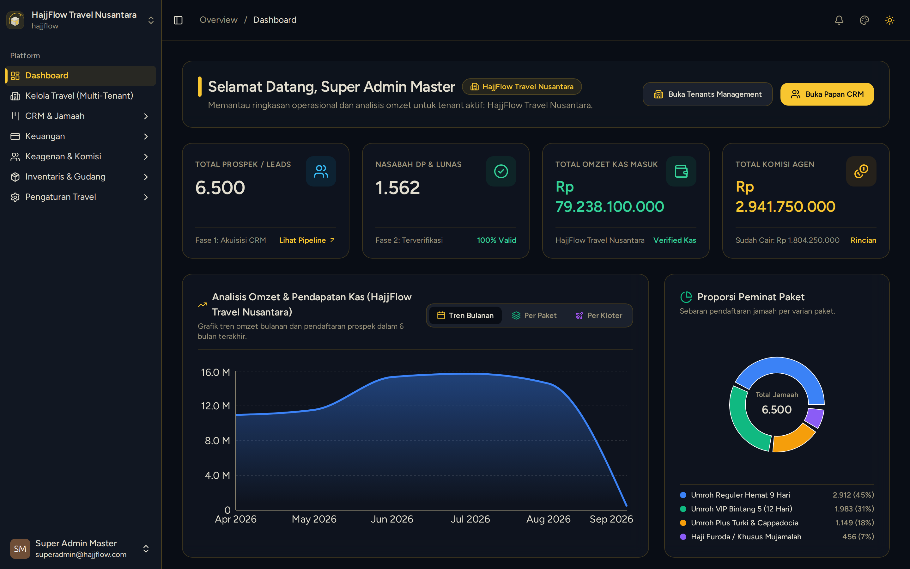

# Panduan Login & Dashboard Utama (Owner)

> **Target Peran**: `Owner (Level 1)` | **Login Akun**: `superadmin@hajjflow.com`
> **Tahapan Alur**: `1. Setup & Master Data` | **Rute Halaman**: `/dashboard`

## 📋 Deskripsi Fitur
Dashboard memberikan visibilitas menyeluruh terhadap kinerja travel, akumulasi omzet, jumlah jamaah, dan grafik tren keberangkatan.

## 🖼️ Tampilan Antarmuka (Owner / Superadmin (Level 1))

## 🛠️ Langkah-Langkah Penggunaan

1. Buka halaman login dan masukkan Email serta Password akun Owner/Admin Anda (`superadmin@hajjflow.com`).
2. Setelah berhasil masuk, Anda akan langsung diarahkan ke Dashboard Utama.
3. Perhatikan ringkasan KPI di bagian atas: Total Jamaah, Omzet Terkumpul, Sisa Tagihan, dan Jumlah Agen Aktif.
4. Gunakan filter rentang tanggal untuk menganalisis data dalam periode tertentu.

## 💡 Tips & Catatan Penting

- 💡 Anda dapat mengganti tema warna aplikasi (Dark/Light/Coffee/Luxury) melalui menu profil di pojok kanan atas.

---
*Dihasilkan secara otomatis oleh Travel Scraper Manual Guide Engine.*
