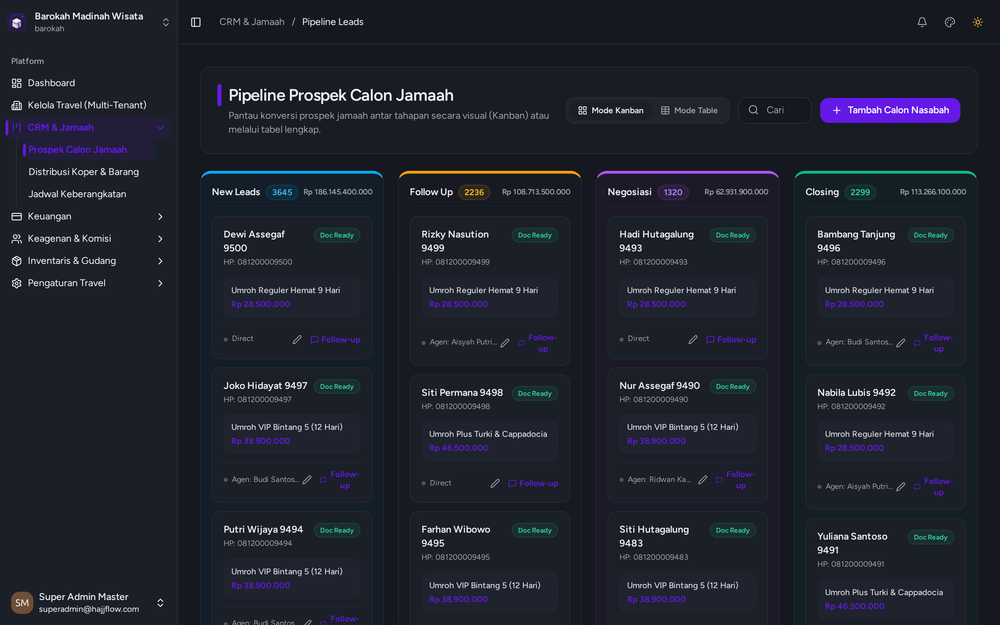

# Manajemen Prospek Jamaah (Kanban Board)

> **Kategori**: `CRM & Pipeline` | **Rute Halaman**: `/crm`

## 📋 Deskripsi Fitur
Papan Kanban interaktif untuk memonitor perpindahan status jamaah dari tahap Inquiry (Calon) hingga Berangkat dan Pasca-Kepulangan.

## 🖼️ Tampilan Antarmuka

## 🛠️ Langkah-Langkah Penggunaan

1. Masuk ke menu CRM > Pipeline Kanban.
2. Setiap kolom mewakili tahapan (Tahap 1: Booking, Tahap 2: DP Terbayar, Tahap 3: Berkas Lengkap, Tahap 4: Pelunasan, Tahap 5: Berangkat).
3. Geser (*drag-and-drop*) kartu jamaah ke kolom sebelah kanan saat jamaah memenuhi syarat tahapan berikutnya.
4. Klik kartu jamaah untuk membuka Laci Detail (Drawer) yang memuat riwayat pembayaran, dokumen paspor, dan kontak agen perujuk.

## 💡 Tips & Catatan Penting

- 💡 Perubahan tahapan di papan Kanban akan langsung tersinkronisasi ke seluruh tim tanpa perlu refresh halaman.

---
*Dihasilkan secara otomatis oleh Travel Scraper Manual Guide Engine.*
