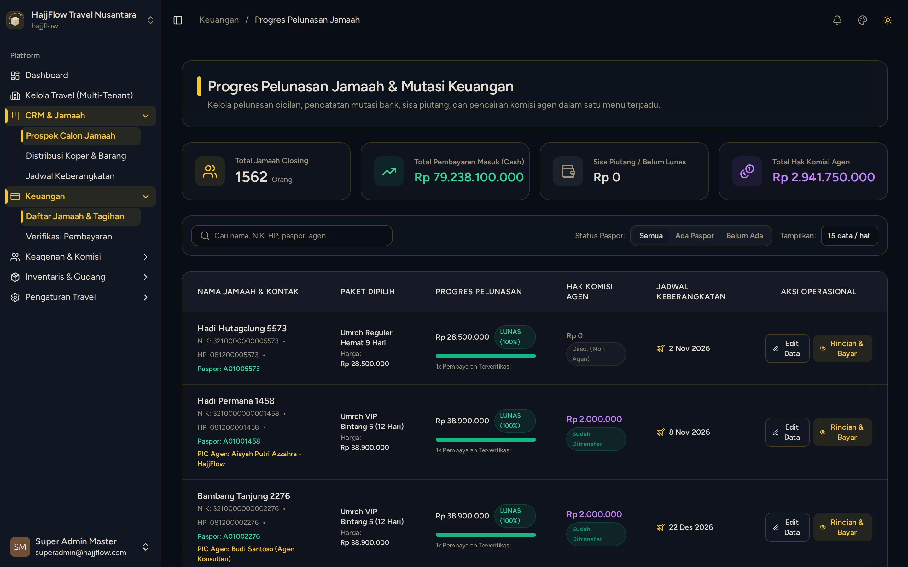

# Data Jamaah, Verifikasi Kasir & Invoice Pembayaran

> **Target Peran**: `Owner (Level 1)` | **Tahapan Alur**: `3. Manajemen Leads & CRM`
> **Kategori Modul**: `CRM & Kasir` | **Rute Halaman**: `/crm/customers`

## 📋 Deskripsi Fitur
Tabel master data seluruh jamaah terdaftar dengan kemampuan pencarian cepat, filter status lunas, dan input pembayaran DP/Pelunasan.

## 🖼️ Tampilan Antarmuka

## 🛠️ Langkah-Langkah Penggunaan

1. Masuk ke menu CRM > Data Jamaah.
2. Gunakan kolom pencarian di bagian atas untuk mencari jamaah berdasarkan Nama, Nomor HP, atau NIK.
3. Klik tombol "Detail / Kasir" pada baris jamaah yang dituju untuk menginput bukti transfer DP atau Pelunasan.
4. Sistem akan otomatis menghitung sisa tagihan dan mencetak bukti pembayaran digital.

## 💡 Tips & Catatan Penting

- 💡 Pastikan rekening tujuan pembayaran sesuai dengan rekening resmi travel yang telah diverifikasi.

---
*Dihasilkan secara otomatis oleh Travel Scraper Manual Guide Engine.*
