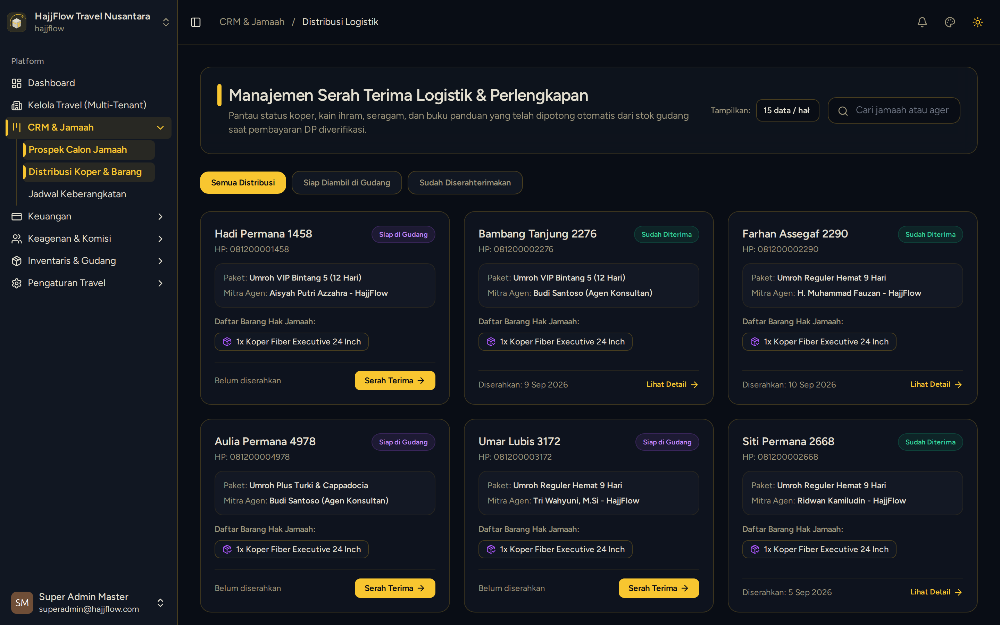

# Distribusi Logistik & Perlengkapan Jamaah

> **Target Peran**: `Owner (Level 1)` | **Tahapan Alur**: `4. Operasional & Keberangkatan`
> **Kategori Modul**: `Logistik & Perlengkapan` | **Rute Halaman**: `/crm/logistics`

## 📋 Deskripsi Fitur
Modul pelacakan pembagian perlengkapan umroh (koper, kain ihram, mukena, seragam, dan buku doa) kepada setiap jamaah.

## 🖼️ Tampilan Antarmuka

## 🛠️ Langkah-Langkah Penggunaan

1. Buka menu CRM > Logistik Jamaah.
2. Pilih paket keberangkatan untuk menyaring jamaah.
3. Centang item perlengkapan yang telah diserahkan kepada jamaah (misal: Koper Bagasi, Kain Ihram).
4. Klik simpan status penyerahan logistik untuk memperbarui data gudang secara real-time.

---
*Dihasilkan secara otomatis oleh Travel Scraper Manual Guide Engine.*
