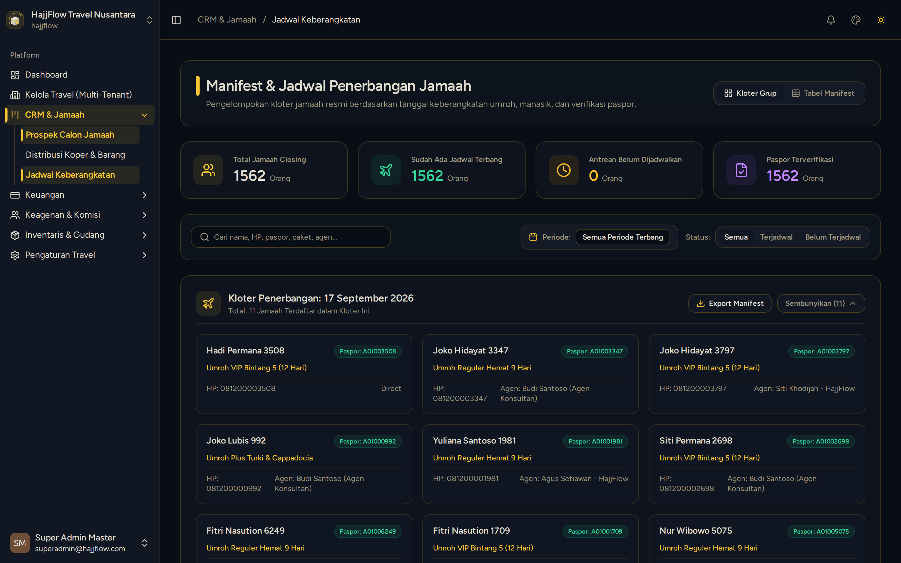

# Jadwal & Kuota Keberangkatan

> **Target Peran**: `Owner (Level 1)` | **Tahapan Alur**: `4. Operasional & Keberangkatan`
> **Kategori Modul**: `Operasional` | **Rute Halaman**: `/crm/schedules`

## 📋 Deskripsi Fitur
Manajemen tanggal keberangkatan, batas kuota kursi penerbangan, hotel Makkah/Madinah, dan status ketersediaan seat.

## 🖼️ Tampilan Antarmuka

## 🛠️ Langkah-Langkah Penggunaan

1. Buka menu Operasional > Jadwal Keberangkatan.
2. Lihat daftar jadwal beserta persentase keterisian kursi (seat occupancy).
3. Klik tombol "Tambah Jadwal" untuk membuka keberangkatan musim baru.
4. Atur batas kuota maksimal agar pendaftaran otomatis tertutup saat kuota penuh.

---
*Dihasilkan secara otomatis oleh Travel Scraper Manual Guide Engine.*
