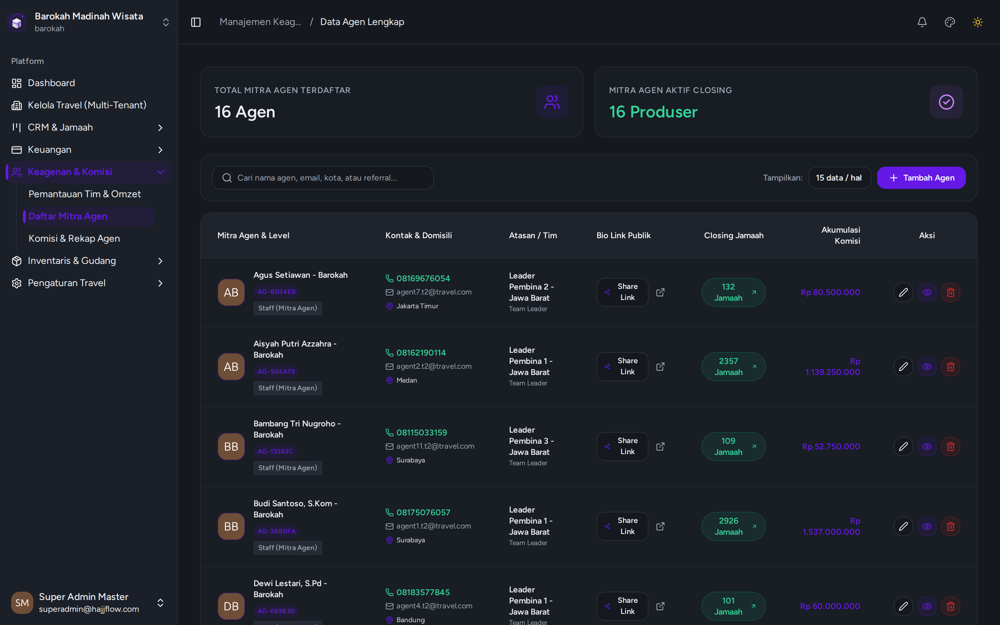

# Manajemen Mitra Agen & Bio Link Mandiri

> **Kategori**: `Keagenan & Kemitraan` | **Rute Halaman**: `/agents`

## 📋 Deskripsi Fitur
Pusat pengelolaan mitra agen travel, pembuatan kode referral unik, dan pembuatan website Bio Link instan untuk masing-masing agen.

## 🖼️ Tampilan Antarmuka

## 🛠️ Langkah-Langkah Penggunaan

1. Buka menu Keagenan > Daftar Mitra Agen.
2. Klik "Tambah Agen Baru" untuk mendaftarkan mitra atau konsultan umroh.
3. Setiap agen memiliki Kode Referral khusus (misal: `AG-88291`).
4. Klik tombol "Salin Bio Link" untuk menyalin tautan promosi agen (misal: `http://travel.com/agen/AG-88291`) yang dapat disebarkan ke media sosial WhatsApp/Instagram.

## 💡 Tips & Catatan Penting

- 💡 Setiap calon jamaah yang mendaftar via Bio Link agen akan otomatis tercatat di bawah komisi agen yang bersangkutan.

---
*Dihasilkan secara otomatis oleh Travel Scraper Manual Guide Engine.*
