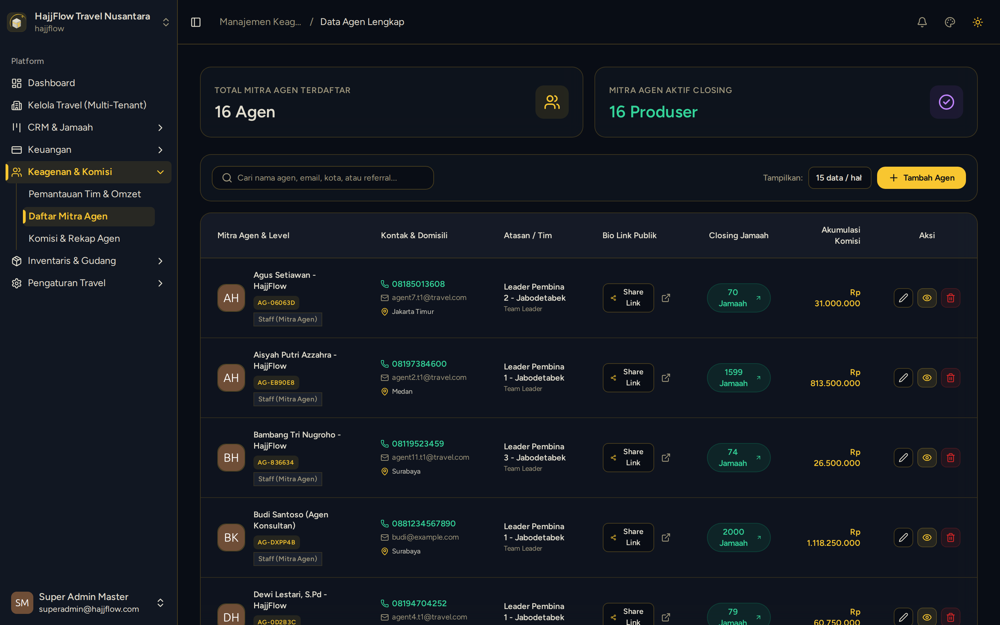

# Manajemen Mitra Agen & Verifikasi Akun

> **Target Peran**: `Owner (Level 1)` | **Tahapan Alur**: `1. Setup & Master Data`
> **Kategori Modul**: `Keagenan & Kemitraan` | **Rute Halaman**: `/agents`

## 📋 Deskripsi Fitur
Pusat pengelolaan mitra agen travel, pembuatan kode referral unik, dan pengaturan izin kemitraan.

## 🖼️ Tampilan Antarmuka

## 🛠️ Langkah-Langkah Penggunaan

1. Buka menu Keagenan > Daftar Mitra Agen.
2. Klik "Tambah Agen Baru" untuk mendaftarkan mitra atau konsultan umroh.
3. Setiap agen memiliki Kode Referral khusus (misal: `AG-504A79`).
4. Verifikasi nomor WhatsApp dan status aktif mitra untuk membuka hak komisi.

---
*Dihasilkan secara otomatis oleh Travel Scraper Manual Guide Engine.*
