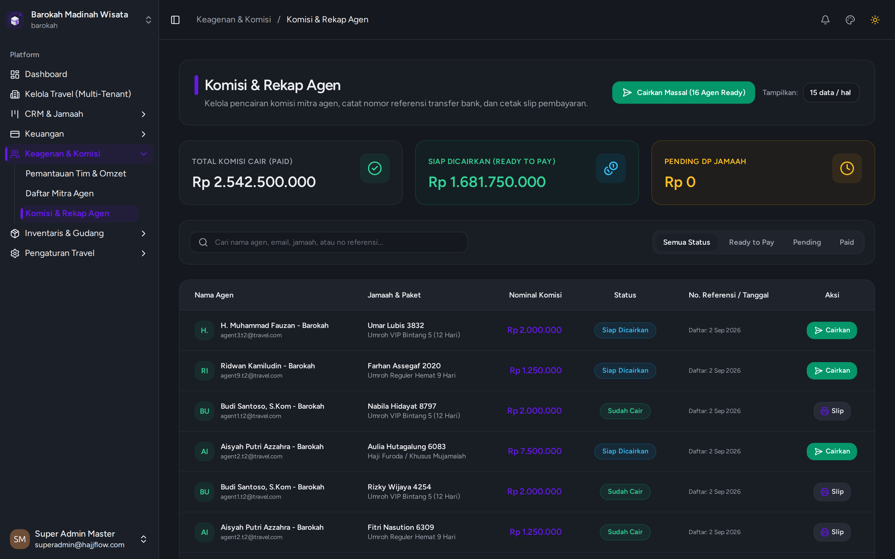

# Pencatatan & Pencairan Komisi Agen

> **Kategori**: `Keagenan & Keuangan` | **Rute Halaman**: `/commissions`

## 📋 Deskripsi Fitur
Rekapitulasi komisi agen berdasarkan skema flat atau persentase per jamaah yang telah menyelesaikan pembayaran.

## 🖼️ Tampilan Antarmuka

## 🛠️ Langkah-Langkah Penggunaan

1. Buka menu Keagenan > Komisi Agen.
2. Lihat status komisi: Pending (menunggu pembayaran jamaah lunas) dan Siap Cair.
3. Klik tombol "Cairkan Komisi" setelah mentransfer hak komisi ke rekening bank agen.
4. Unggah atau catat nomor referensi transfer bank sebagai bukti audit keuangan.

---
*Dihasilkan secara otomatis oleh Travel Scraper Manual Guide Engine.*
