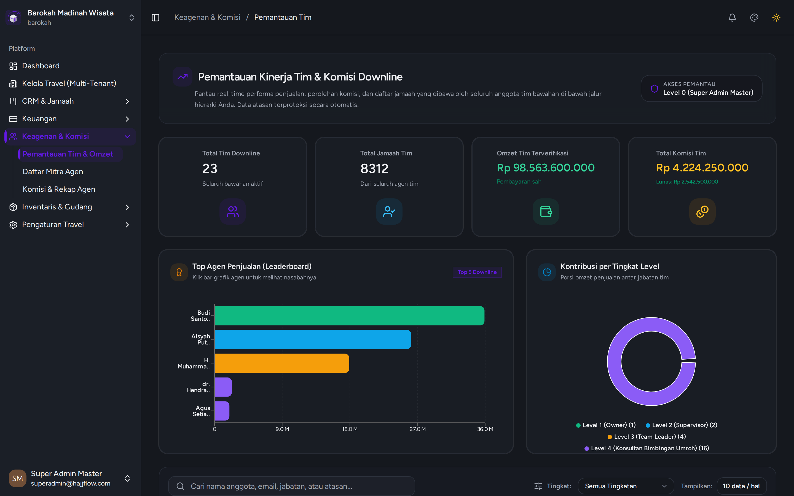

# Monitoring Kinerja & Struktur Tim Agen

> **Kategori**: `Keagenan & Hierarki` | **Rute Halaman**: `/monitoring`

## 📋 Deskripsi Fitur
Visualisasi pohon jaringan (hierarki leader, agen silver, agen gold) beserta perolehan omzet per grup tim.

## 🖼️ Tampilan Antarmuka

## 🛠️ Langkah-Langkah Penggunaan

1. Buka menu Keagenan > Monitoring Tim.
2. Pilih nama Leader untuk melihat seluruh struktur downline/sub-agen di bawahnya.
3. Pantau kontribusi jumlah jamaah dan total akumulasi omzet dari masing-masing level keagenan.

---
*Dihasilkan secara otomatis oleh Travel Scraper Manual Guide Engine.*
