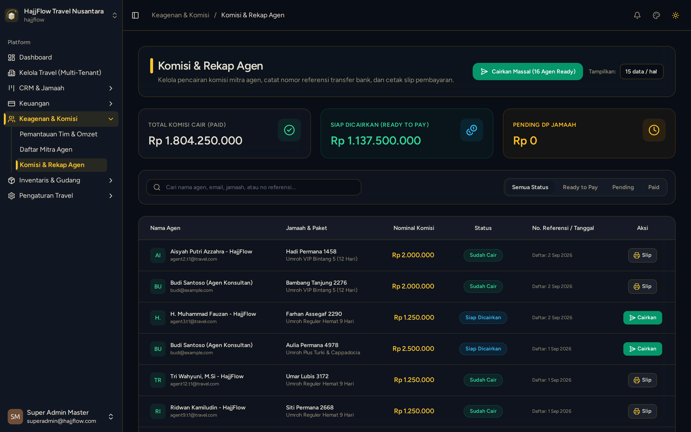

# Pencatatan & Pencairan Komisi Agen

> **Target Peran**: `Semua Role` | **Login Akun**: `superadmin@hajjflow.com`
> **Tahapan Alur**: `5. Keuangan & Komisi` | **Rute Halaman**: `/commissions`

## 📋 Deskripsi Fitur
Rekapitulasi komisi agen berdasarkan skema flat atau persentase per jamaah yang telah menyelesaikan pembayaran.

## 🖼️ Tampilan Antarmuka (Owner / Superadmin (Level 1))

## 🛠️ Langkah-Langkah Penggunaan

1. Buka menu Keagenan > Komisi Agen.
2. Lihat status komisi: Pending (menunggu pembayaran jamaah lunas) dan Siap Cair.
3. Bagi Owner: Klik tombol "Cairkan Komisi" setelah mentransfer hak komisi ke rekening bank agen.
4. Bagi Agen: Pantau riwayat transfer dan akumulasi komisi yang sudah dibayarkan.

---
*Dihasilkan secara otomatis oleh Travel Scraper Manual Guide Engine.*
