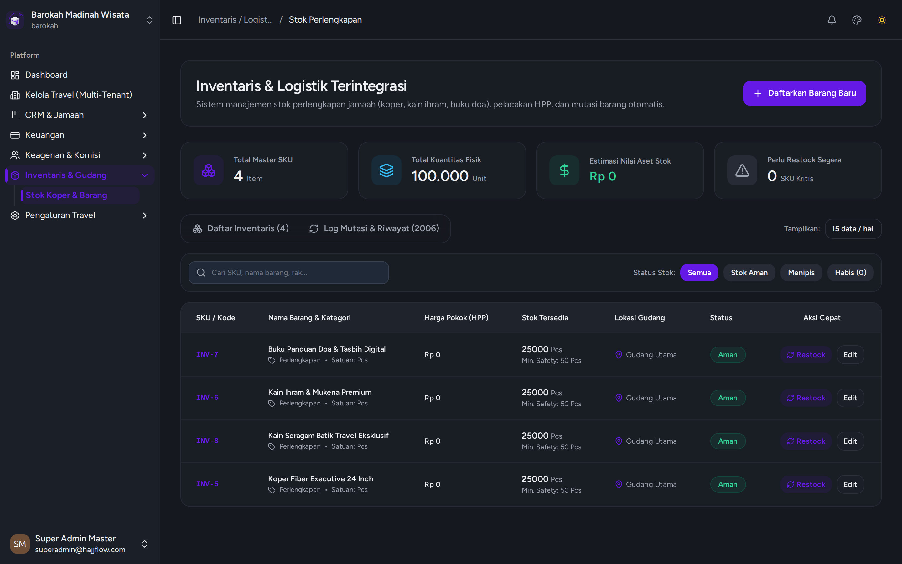

# Inventaris Stok & Perlengkapan Gudang

> **Kategori**: `Gudang & Inventaris` | **Rute Halaman**: `/inventaris`

## 📋 Deskripsi Fitur
Pencatatan stok fisik perlengkapan travel, peringatan stok minimum, dan riwayat mutasi barang masuk/keluar.

## 🖼️ Tampilan Antarmuka

## 🛠️ Langkah-Langkah Penggunaan

1. Buka menu Inventaris > Stok Perlengkapan.
2. Periksa jumlah stok saat ini pada item Koper, Kain Ihram, Mukena, Batik, dll.
3. Klik "Tambah Barang Masuk" saat menerima pengiriman barang dari vendor konveksi.
4. Sistem akan otomatis mengurangi stok ketika item dibagikan ke jamaah di modul Logistik.

---
*Dihasilkan secara otomatis oleh Travel Scraper Manual Guide Engine.*
