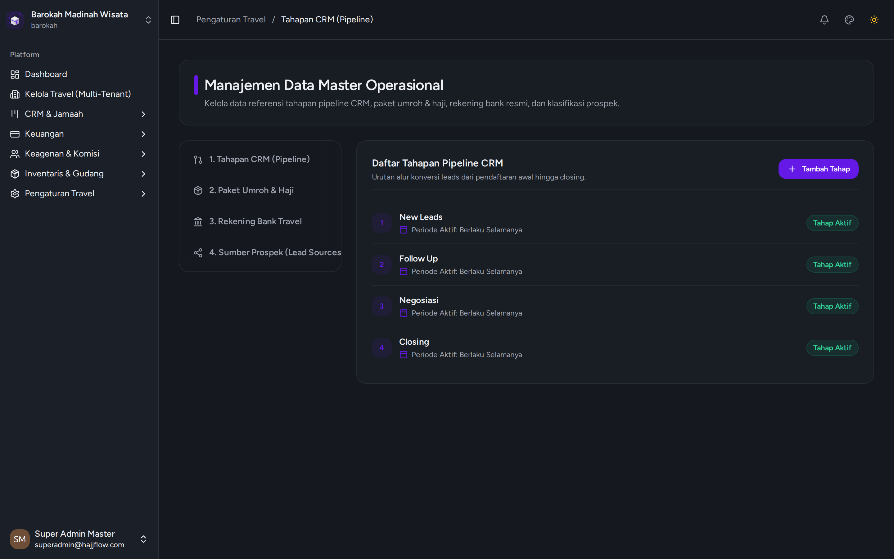

# Pengaturan Data Master, Paket Umroh & Rekening Bank

> **Kategori**: `Pengaturan` | **Rute Halaman**: `/settings/master`

## 📋 Deskripsi Fitur
Konfigurasi master paket umroh, harga, komisi default, fasilitas hotel, rekening bank resmi, dan sumber leads.

## 🖼️ Tampilan Antarmuka

## 🛠️ Langkah-Langkah Penggunaan

1. Buka menu Pengaturan > Data Master.
2. Tab "Paket Umroh": Tambah atau edit paket, atur harga, nominal komisi agen, dan item perlengkapan bawaan paket.
3. Tab "Rekening Bank": Kelola daftar rekening resmi travel yang tampil di formulir transfer jamaah.
4. Tab "Tahapan CRM": Kustomisasi nama kolom alur tahapan pipa penjualan.

---
*Dihasilkan secara otomatis oleh Travel Scraper Manual Guide Engine.*
