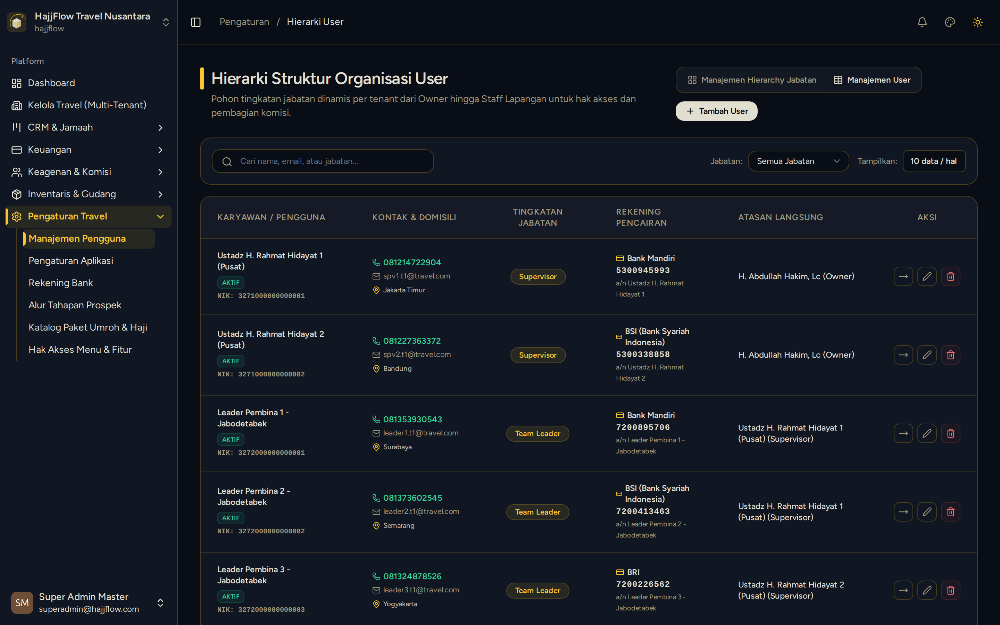

# Pengaturan Pengguna & Hierarki Level Jabatan

> **Target Peran**: `Owner (Level 1)` | **Tahapan Alur**: `1. Setup & Master Data`
> **Kategori Modul**: `Pengaturan Akun` | **Rute Halaman**: `/settings/users`

## 📋 Deskripsi Fitur
Pengelolaan akun pengguna staff internal (Owner, Admin, Keuangan, Kasir) dan penentuan jenjang level kemitraan agen.

## 🖼️ Tampilan Antarmuka

## 🛠️ Langkah-Langkah Penggunaan

1. Buka menu Pengaturan > Hirarki Pengguna & Level.
2. Klik "Tambah Pengguna" untuk memberikan akses login ke staf baru.
3. Tentukan peran (Role) dan atasan langsung (Upline / Atasan).
4. Gunakan tombol "Reassign / Pindahkan Bawahan" jika ada perubahan struktur mutasi staf.

---
*Dihasilkan secara otomatis oleh Travel Scraper Manual Guide Engine.*
