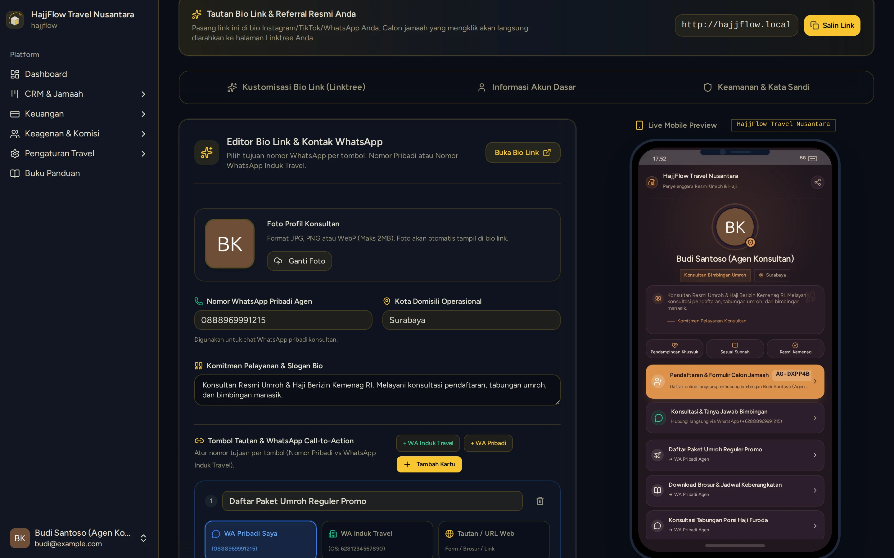

# Setup Profil, Password & Live Customizer Bio Link

> **Target Peran**: `Mitra Agen (Level 2/3)` | **Login Akun**: `budi@example.com`
> **Tahapan Alur**: `1. Setup Profil & Branding Mandiri` | **Kategori**: `Promosi & Profil Akun` | **Rute / URL**: `/profile`

## 📋 Deskripsi Fitur
Pusat pengaturan profil akun agen, ganti password, nomor WhatsApp konsultasi, bio sambutan, tautan media sosial, serta live preview tampilan mobile sebelum disebarkan ke publik.

## 🖼️ Tampilan Antarmuka Utama

## 🗂️ Tampilan Drawer, Modal & Aksi Detail

### 📸 Tampilan Live Preview

## ⚡ Aksi & Fitur Lengkap (CRUD Matrix)

### 🔍 Read (Lihat / Pencarian / Filter Data)
- Melihat tampilan preview real-time landing page pada bingkai smartphone mockup di sebelah kanan layar.

### ✏️ Update (Edit / Pembaruan Status)
- Edit Nama Konsultan, Kota Domisili, Nomor WA Konsultasi, dan Bio Sambutan.
- Atur tombol tindakan cepat: WhatsApp Konsultasi Pribadi, WhatsApp CS Travel Pusat, atau Formulir Pendaftaran.
- Tautkan akun sosial media (Instagram, TikTok, YouTube, Facebook).
- Perbarui Kata Sandi / Password login akun agen.

### ✨ Fitur Khusus & Otomasi
- Live Mobile Mockup Preview interaktif.
- Salin Tautan Bio Link Personal (contoh: `http://barokah.travel.com/agen/AG-504A79`) untuk dipasang di bio Instagram/TikTok/WhatsApp.

## 🛠️ Langkah-Langkah Penggunaan

1. Login ke sistem menggunakan akun Mitra Agen (`agent2.t2@travel.com`).
2. Buka menu Profil Akun > Pengaturan Bio Link Agen.
3. Lengkapi Foto Profil diri, Kota Domisili, Nomor WhatsApp, dan Bio Sambutan.
4. Periksa hasil tampilan pada Live Mobile Preview di sisi kanan.
5. Klik tombol "Simpan Perubahan" dan salin link landing page personal Anda.

## 💡 Tips & Catatan Penting

- 💡 Pasang tautan Bio Link Anda pada Profil Instagram dan status WhatsApp untuk menjaring calon jamaah secara otomatis.

---
*Buku Panduan Resmi Sistem Travel Umroh Multi-Tenant.*
