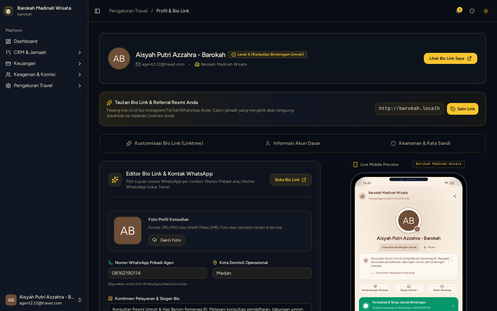

# Setup Profil Bio Link & Landing Page Agen

> **Target Peran**: `Agen Mitra (Level 2/3)` | **Login Akun**: `agent2.t2@travel.com`
> **Tahapan Alur**: `1. Setup Profil & Branding Mandiri` | **Kategori**: `Promosi & Digital Marketing` | **Rute**: `/profile`

## 📋 Deskripsi Fitur
Pusat kustomisasi website mini Bio Link personal agen (Linktree Islami) yang berfungsi sebagai etalase promosi online dan media penangkap leads jamaah.

## 🖼️ Tampilan Antarmuka

## ⚡ Aksi & Fitur Lengkap (CRUD Matrix)

### 🔍 Read (Lihat / Pencarian / Filter Data)
- Melihat tampilan preview real-time landing page pada bingkai smartphone mockup di sebelah kanan layar.

### ✏️ Update (Edit / Pembaruan Status)
- Edit Nama Konsultan, Kota Domisili, dan Kalimat Komitmen Amanah.
- Atur tombol tindakan cepat: WhatsApp Konsultasi Pribadi, WhatsApp CS Travel Pusat, atau Formulir Pendaftaran.
- Tautkan akun sosial media (Instagram, TikTok, YouTube, Facebook).

### ✨ Fitur Khusus & Otomasi
- Salin Tautan Bio Link Personal (contoh: `http://travel.com/agen/AG-504A79`) untuk disebarkan ke media sosial.

## 🛠️ Langkah-Langkah Penggunaan

1. Login ke sistem menggunakan akun Mitra Agen (`agent2.t2@travel.com`).
2. Buka menu Profil Akun > Pengaturan Bio Link Agen.
3. Lengkapi Foto Profil diri, Kota Domisili, dan Bio Singkat.
4. Periksa hasil tampilan pada Live Mobile Preview di sisi kanan.
5. Klik tombol "Simpan Perubahan" dan salin link landing page personal Anda.

## 💡 Tips & Catatan Penting

- 💡 Pasang tautan Bio Link Anda pada Profil Instagram dan status WhatsApp untuk menjaring calon jamaah secara otomatis.

---
*Buku Panduan Resmi Sistem Travel Umroh Multi-Tenant.*
