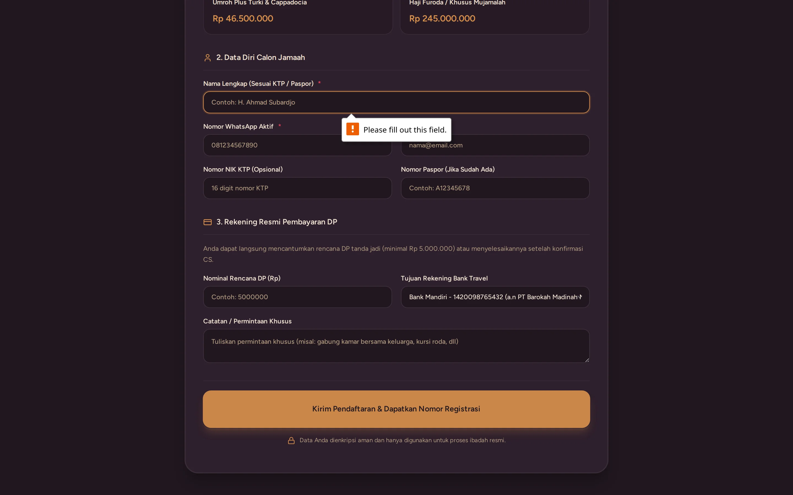

# Formulir Pendaftaran Online Mandiri Jamaah (Referral Link)

> **Target Peran**: `Mitra Agen (Level 2/3)` | **Login Akun**: `budi@example.com`
> **Tahapan Alur**: `2. Pendaftaran & Akuisisi Calon Jamaah` | **Kategori**: `Registrasi & Referral Jamaah` | **Rute / URL**: `http://barokah.localhost:8000/daftar?ref=AG-504A79`

## 📋 Deskripsi Fitur
Formulir pendaftaran mandiri calon jamaah via tautan referral agen. Memuat informasi paket yang dipilih, data diri calon jamaah, nomor paspor, pilihan kamar, dan nomor rekening resmi travel untuk transfer DP. Agen otomatis tercatat sebagai pembina jamaah.

## 🖼️ Tampilan Antarmuka Utama

## 🗂️ Tampilan Drawer, Modal & Aksi Detail

### 📸 Tampilan Validasi Error

## ⚡ Aksi & Fitur Lengkap (CRUD Matrix)

### ➕ Create (Tambah / Input Baru)
- Calon jamaah mengisi formulir online: Nama Lengkap, Nomor WhatsApp, Email, NIK KTP, Alamat, Pilihan Paket, dan Pilihan Kamar (Quad/Triple/Double).

### 🔍 Read (Lihat / Pencarian / Filter Data)
- Menampilkan banner verifikasi mitra agen pembina (`Referral: Aisyah Putri Azzahra - Barokah`).
- Menampilkan daftar nomor rekening bank resmi travel untuk pembayaran DP.

### ✨ Fitur Khusus & Otomasi
- Calon jamaah otomatis terdaftar dan masuk ke tahap "Booking" di CRM sistem travel.
- Notifikasi otomatis dikirimkan ke WhatsApp agen pembina dan staf travel pusat.

## 🛠️ Langkah-Langkah Penggunaan

1. Calon jamaah mengklik tombol pendaftaran dari Bio Link agen atau menerima link referral langsung.
2. Calon jamaah mengisi data diri lengkap pada formulir online.
3. Calon jamaah memilih metode pembayaran dan mentransfer DP ke rekening resmi travel.
4. Data langsung tersimpan dan muncul di Kanban CRM agen serta travel pusat.

---
*Buku Panduan Resmi Sistem Travel Umroh Multi-Tenant.*
