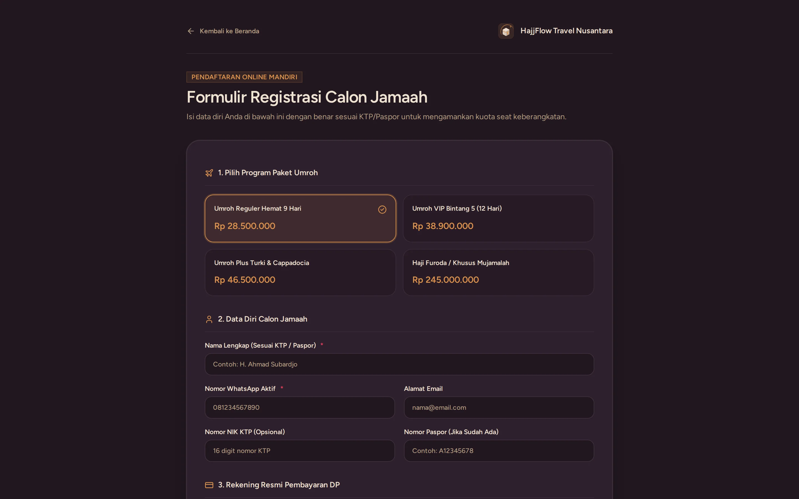

# Alur Form Pendaftaran Publik → Masuk New Leads CRM (Agen)

> **Target Peran**: `Mitra Agen (Level 2/3)` | **Login Akun**: `budi@example.com`
> **Tahapan Alur**: `2. Pendaftaran & Akuisisi Calon Jamaah` | **Kategori**: `Digital Marketing & Leads Capture` | **Rute / URL**: `/daftar`

## 📋 Deskripsi Fitur
Alur end-to-end: calon jamaah mengisi formulir publik via link referral agen → data otomatis masuk ke sistem sebagai New Leads di papan CRM agen. Agen tidak perlu mengentry ulang data apapun.

## 🖼️ Tampilan Antarmuka Utama

## ⚡ Aksi & Fitur Lengkap (CRUD Matrix)

### ➕ Create (Tambah / Input Baru)
- Calon jamaah membuka link referral agen: contoh `/daftar?ref=AG-DXPP4B`.
- Mengisi formulir: Nama, No WA, Email, NIK, Alamat, dan Pilihan Paket.
- Klik Submit ➔ data langsung tersimpan di database.

### 🔍 Read (Lihat / Pencarian / Filter Data)
- Agen login ke dashboard ➔ buka CRM > Kanban ➔ kartu jamaah baru muncul di kolom **New Leads**.
- Notifikasi otomatis masuk ke dashboard agen bahwa ada leads baru.

### ✨ Fitur Khusus & Otomasi
- Kode referral agen tertanam otomatis di URL sehingga tidak perlu diisi manual oleh calon jamaah.
- Agen terdaftar sebagai pembina tetap jamaah tersebut selama proses hingga closing.

## 🛠️ Langkah-Langkah Penggunaan

1. Agen menyebarkan link referral: `http://hajjflow.localhost:8000/daftar?ref=AG-DXPP4B` ke WhatsApp atau media sosial.
2. Calon jamaah membuka link dan mengisi formulir pendaftaran.
3. Klik tombol Daftar / Submit.
4. Agen login ke dashboard ➔ buka CRM > Kanban ➔ pastikan kartu jamaah baru muncul di kolom New Leads.
5. Klik kartu jamaah untuk melengkapi atau memverifikasi data yang diisi.

## 💡 Tips & Catatan Penting

- 💡 Bagikan link referral di story Instagram setiap hari untuk mendapatkan leads organik secara konsisten.

---
*Buku Panduan Resmi Sistem Travel Umroh Multi-Tenant.*
