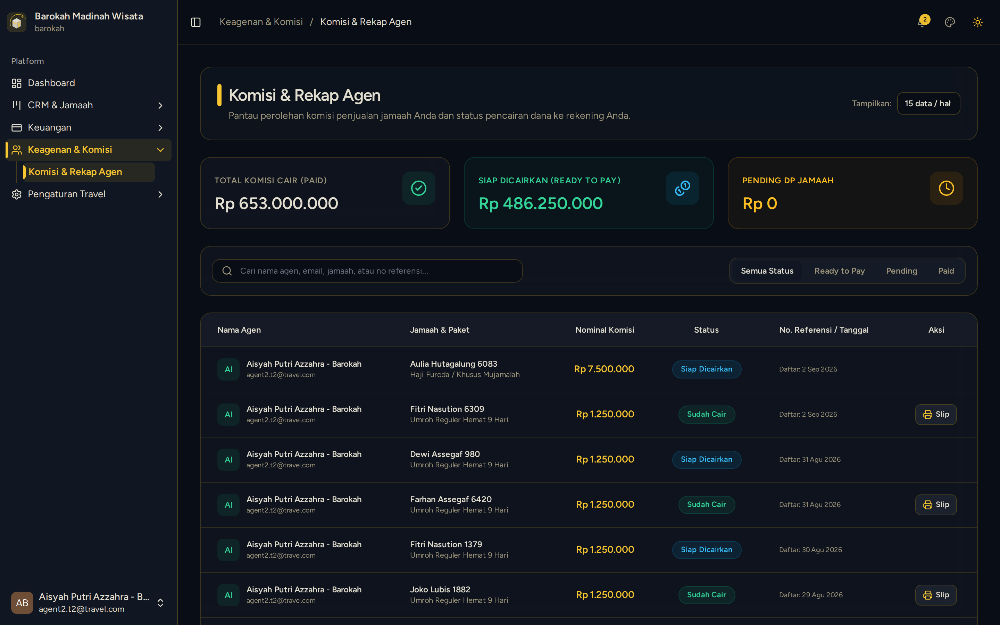

# Rekap Komisi Penjualan & Saldo Agen

> **Target Peran**: `Agen Mitra (Level 2/3)` | **Login Akun**: `agent2.t2@travel.com`
> **Tahapan Alur**: `4. Hasil Penjualan & Payout` | **Kategori**: `Keuangan & Reward` | **Rute**: `/commissions`

## 📋 Deskripsi Fitur
Pusat transparansi saldo komisi agen, riwayat komisi per jamaah yang telah lunas, dan status pencairan dana oleh kantor pusat.

## 🖼️ Tampilan Antarmuka

## ⚡ Aksi & Fitur Lengkap (CRUD Matrix)

### 🔍 Read (Lihat / Pencarian / Filter Data)
- Melihat Akumulasi Total Komisi yang sudah dicairkan.
- Melihat Komisi Siap Cair (jamaah telah lunas dan siap ditransfer kantor pusat).
- Melihat Komisi Pending (jamaah masih dalam proses cicilan/DP).
- Melihat rincian komisi override jika agen memiliki sub-agen binaan (Level Leader).

## 🛠️ Langkah-Langkah Penggunaan

1. Buka menu Keagenan > Komisi Saya.
2. Periksa status komisi jamaah yang baru saja menyelesaikan pelunasan.
3. Pantau status transfer pencairan dari pihak manajemen travel.

---
*Buku Panduan Resmi Sistem Travel Umroh Multi-Tenant.*
