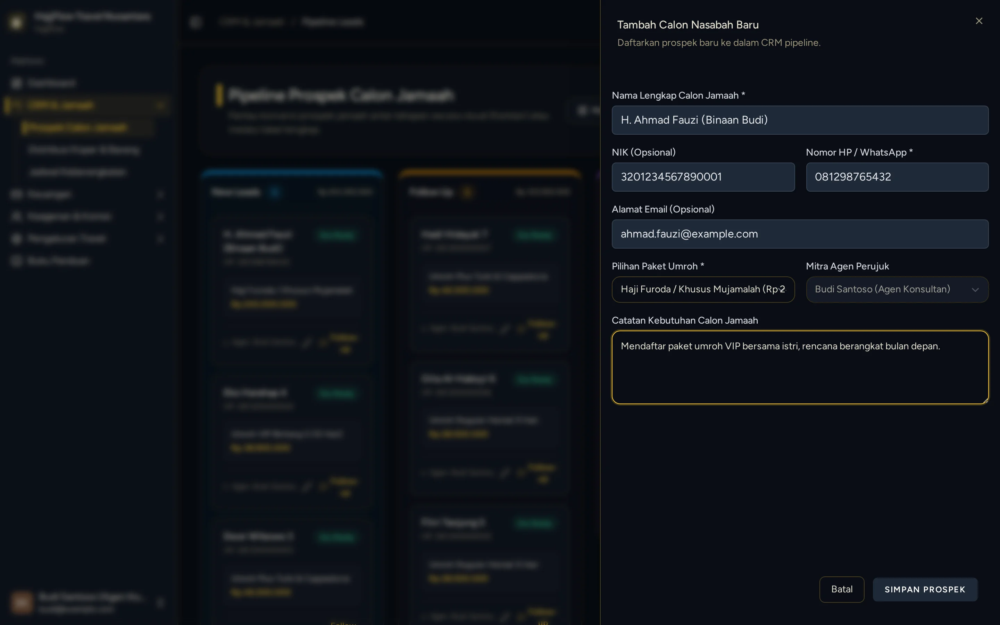
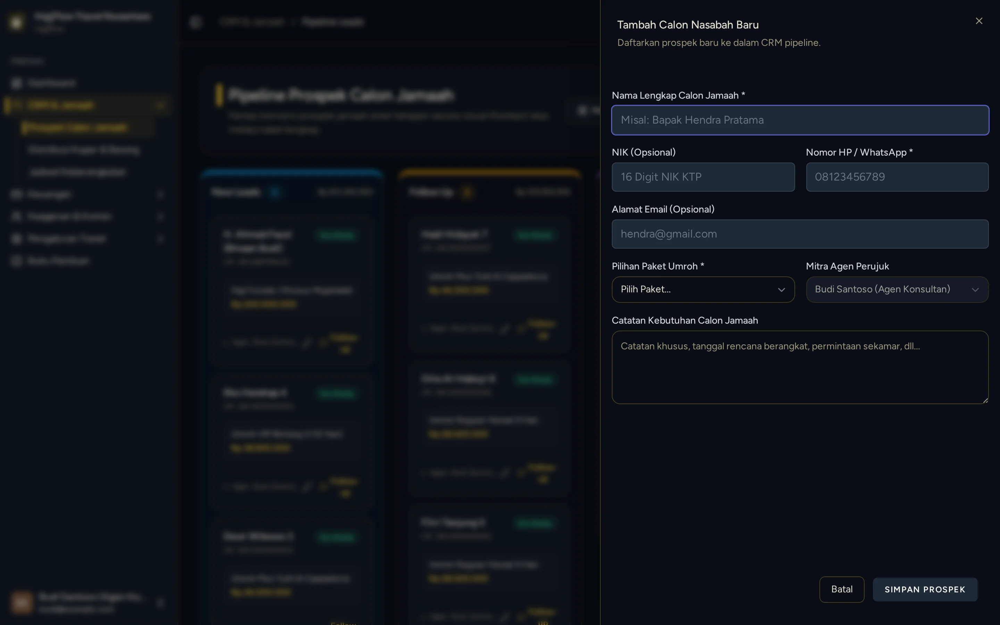

# Pendaftaran & Input Data Jamaah Binaan Secara Manual (Internal Agen)

> **Target Peran**: `Mitra Agen (Level 2/3)` | **Login Akun**: `budi@example.com`
> **Tahapan Alur**: `2. Pendaftaran & Akuisisi Calon Jamaah` | **Kategori**: `Penjualan & Pendaftaran` | **Rute / URL**: `/crm`

## 📋 Deskripsi Fitur
Agen dapat mendaftarkan jamaah secara manual dari dashboard jika calon jamaah mendaftar secara tatap muka (offline) atau melalui chat pribadi tanpa mengklik link referral.

## 🖼️ Tampilan Antarmuka Utama

## 🗂️ Tampilan Drawer, Modal & Aksi Detail

### 📸 Tampilan Form Terisi

### 📸 Tampilan Modal Tambah

## ⚡ Aksi & Fitur Lengkap (CRUD Matrix)

### ➕ Create (Tambah / Input Baru)
- Klik "+ Tambah Calon Nasabah" untuk menginput data calon jamaah binaan (Nama, No WA, Alamat, Pilihan Paket).

### 🔍 Read (Lihat / Pencarian / Filter Data)
- Melihat daftar seluruh jamaah yang terdaftar di bawah referral agen Anda.

### ✏️ Update (Edit / Pembaruan Status)
- Perbarui berkas dokumen jamaah (unggah foto Paspor, KTP, Kartu Keluarga, dan Buku Nikah).

## 🛠️ Langkah-Langkah Penggunaan

1. Login sebagai Agen, buka menu CRM > Pipeline Leads.
2. Klik tombol "+ Tambah Calon Nasabah".
3. Isi formulir: Nama Lengkap, No HP/WA, NIK, Alamat, dan pilih Paket Umroh yang diminati.
4. Klik Simpan ➔ jamaah otomatis tercatat sebagai binaan agen dan masuk stage New Leads.

---
*Buku Panduan Resmi Sistem Travel Umroh Multi-Tenant.*
