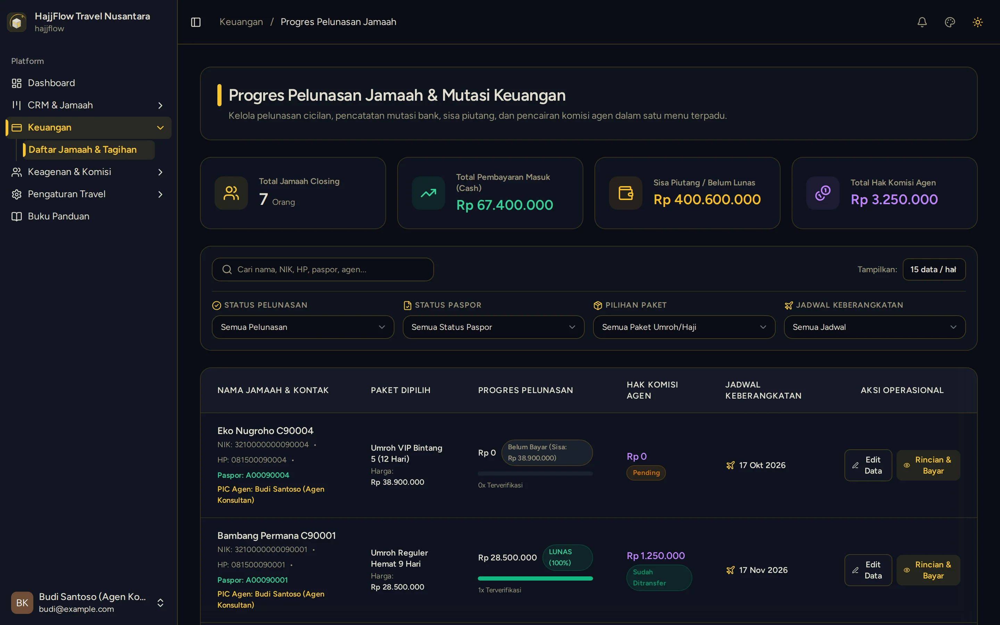
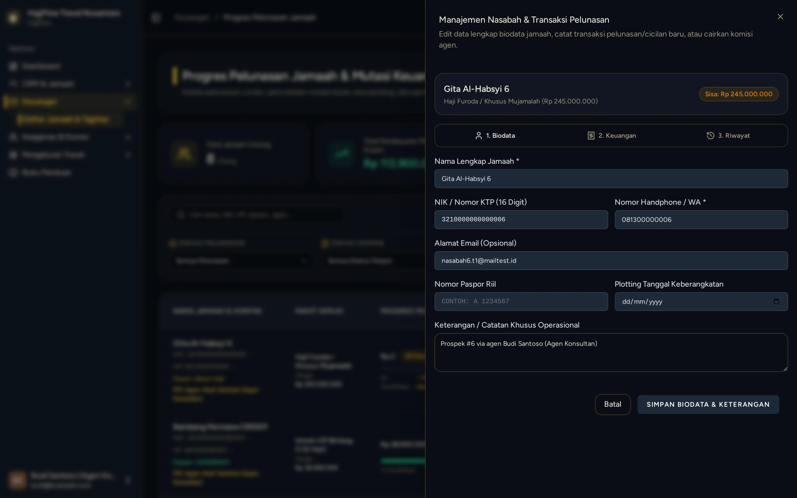
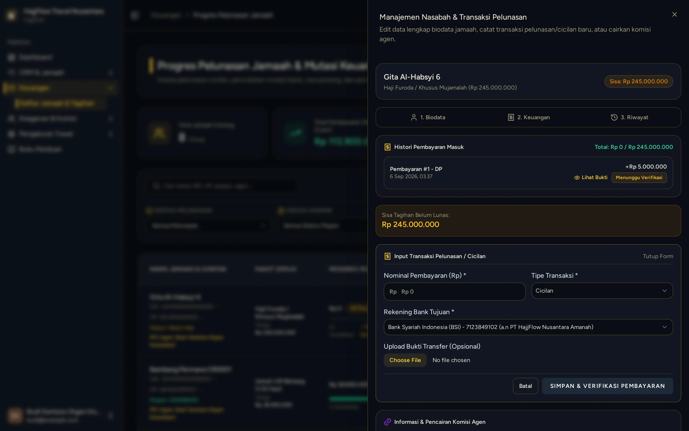
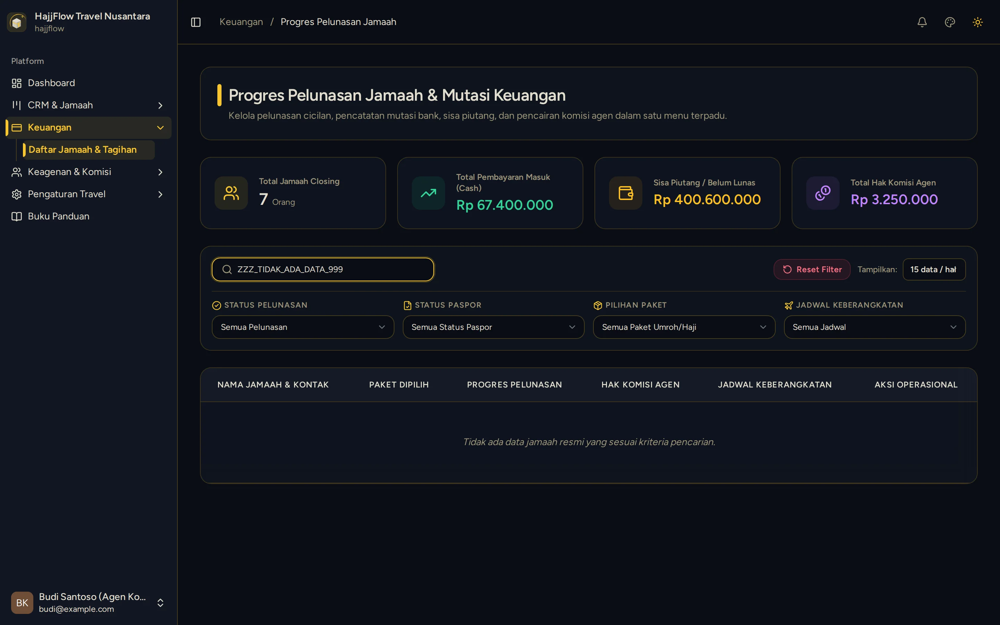

# Upload Bukti Transfer Pembayaran oleh Agen

> **Target Peran**: `Mitra Agen (Level 2/3)` | **Login Akun**: `budi@example.com`
> **Tahapan Alur**: `3. Pengawalan Prospek Hingga Lunas` | **Kategori**: `Penjualan & Pembayaran` | **Rute / URL**: `/crm/customers`

## 📋 Deskripsi Fitur
Setelah jamaah binaan mentransfer DP atau cicilan ke rekening travel, agen mengunggah foto bukti transfer dari dashboard agen. Bukti akan diperiksa dan disetujui oleh pihak manajemen travel.

## 🖼️ Tampilan Antarmuka Utama

## 🗂️ Tampilan Drawer, Modal & Aksi Detail

### 📸 Tampilan Drawer Biodata

### 📸 Tampilan Drawer Financial

### 📸 Tampilan Empty State

## ⚡ Aksi & Fitur Lengkap (CRUD Matrix)

### ➕ Create (Tambah / Input Baru)
- Buka detail jamaah ➔ klik tombol "Rincian & Bayar" ➔ klik "Catat Pelunasan / Cicilan".
- Pilih Tipe: DP atau Cicilan.
- Isi Nominal yang ditransfer jamaah.
- Unggah foto/screenshot bukti transfer dari galeri atau kamera.
- Klik Simpan ➔ status pembayaran menjadi Pending Verifikasi.

### 🔍 Read (Lihat / Pencarian / Filter Data)
- Pantau status verifikasi di panel detail jamaah: Pending → Verified.
- Lihat riwayat semua pembayaran beserta nominal dan tanggal.

### ✨ Fitur Khusus & Otomasi
- Setelah diverifikasi oleh kantor travel, saldo komisi agen otomatis masuk ke rekap komisi agen.

## 🛠️ Langkah-Langkah Penggunaan

1. Login sebagai Agen, buka CRM > Data Jamaah.
2. Cari nama jamaah yang baru saja mentransfer DP.
3. Klik tombol "Rincian & Bayar" pada baris jamaah.
4. Klik tombol "Catat Pelunasan / Cicilan".
5. Isi nominal DP, pilih rekening tujuan yang dipakai jamaah, dan unggah foto bukti transfer.
6. Klik Simpan — status berubah ke Pending dan menunggu verifikasi dari kantor travel.

## 💡 Tips & Catatan Penting

- 💡 Pastikan foto bukti transfer jelas dan terbaca (nama pengirim, nominal, dan tanggal transfer harus terlihat).

---
*Buku Panduan Resmi Sistem Travel Umroh Multi-Tenant.*
