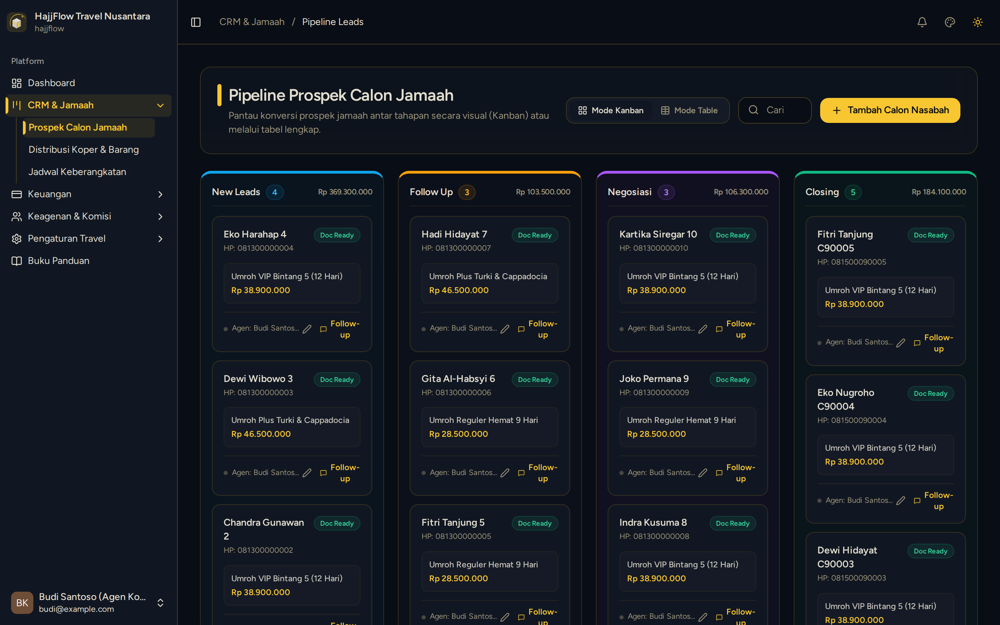
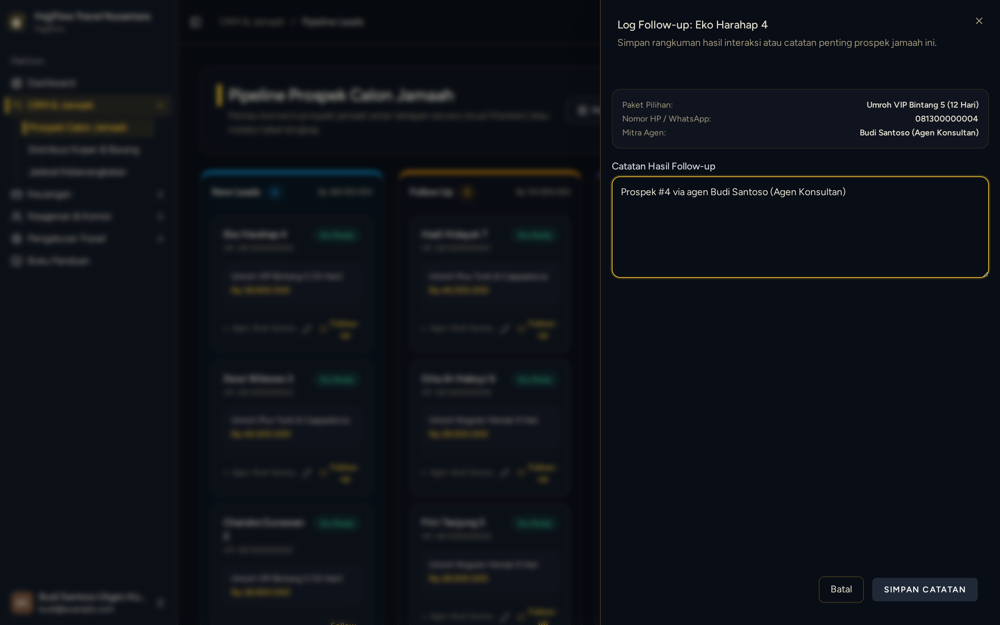

# Memantau Status Pembayaran & Pindah Stage Kanban (Agen)

> **Target Peran**: `Mitra Agen (Level 2/3)` | **Login Akun**: `budi@example.com`
> **Tahapan Alur**: `3. Pengawalan Prospek Hingga Lunas` | **Kategori**: `CRM & Follow Up` | **Rute / URL**: `/crm`

## 📋 Deskripsi Fitur
Setelah bukti transfer diverifikasi oleh kantor, agen dapat memantau perpindahan status jamaah di papan Kanban CRM dan memindahkan stage jamaah yang sudah negosiasi ke tahap berikutnya.

## 🖼️ Tampilan Antarmuka Utama

## 🗂️ Tampilan Drawer, Modal & Aksi Detail

### 📸 Tampilan Modal Followup

## ⚡ Aksi & Fitur Lengkap (CRUD Matrix)

### 🔍 Read (Lihat / Pencarian / Filter Data)
- Lihat status terkini kartu jamaah di setiap kolom Kanban (New Leads, Follow Up, Negosiasi, Closing).
- Kartu jamaah yang sudah terverifikasi pembayarannya akan berpindah stage secara otomatis.

### ✏️ Update (Edit / Pembaruan Status)
- Agen dapat memindahkan stage jamaah secara manual via tombol aksi di panel detail jamaah.
- Tambahkan catatan follow-up atau pengingat konsultasi di panel detail jamaah.

### ✨ Fitur Khusus & Otomasi
- Filter Kanban berdasarkan stage tertentu untuk fokus follow-up pada leads yang sudah siap closing.

## 🛠️ Langkah-Langkah Penggunaan

1. Login sebagai Agen, buka CRM > Pipeline Kanban.
2. Pantau kartu jamaah yang baru saja diupload bukti transfernya.
3. Setelah status diverifikasi kantor, kartu otomatis berpindah stage.
4. Untuk memindahkan manual: klik kartu jamaah ➔ ubah stage ➔ simpan.
5. Lakukan follow-up pada jamaah di kolom New Leads dan Follow Up untuk mendorong ke tahap Negosiasi.

## 💡 Tips & Catatan Penting

- 💡 Jamaah di kolom Follow Up yang belum bergerak selama 7 hari perlu dihubungi ulang via WhatsApp untuk menghindari leads dingin.

---
*Buku Panduan Resmi Sistem Travel Umroh Multi-Tenant.*
