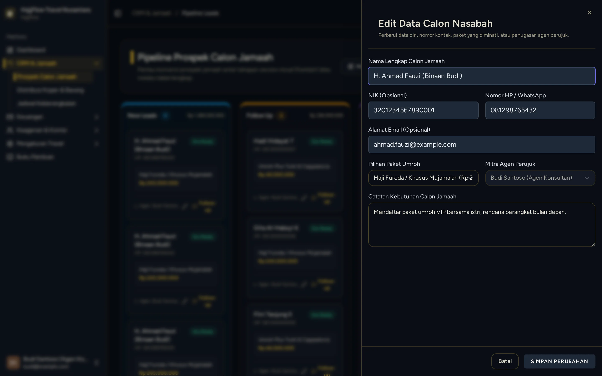

# Monitoring Pipeline Kanban Jamaah Binaan

> **Target Peran**: `Mitra Agen (Level 2/3)` | **Login Akun**: `budi@example.com`
> **Tahapan Alur**: `3. Pengawalan Prospek Hingga Lunas` | **Kategori**: `CRM & Follow Up` | **Rute / URL**: `/crm`

## 📋 Deskripsi Fitur
Papan Kanban visual khusus bagi agen untuk mengawal jamaah binaan melewati setiap tahapan: Booking ➔ DP Terbayar ➔ Berkas Lengkap ➔ Pelunasan ➔ Siap Berangkat.

## 🖼️ Tampilan Antarmuka Utama

## 🗂️ Tampilan Drawer, Modal & Aksi Detail

### 📸 Tampilan Drawer Edit

## ⚡ Aksi & Fitur Lengkap (CRUD Matrix)

### 🔍 Read (Lihat / Pencarian / Filter Data)
- Memantau status tahapan terkini dari seluruh jamaah binaan agen.

### ✏️ Update (Edit / Pembaruan Status)
- Buka laci detail jamaah untuk mengecek status validasi dokumen paspor dan visa oleh pihak travel.

## 🛠️ Langkah-Langkah Penggunaan

1. Buka menu CRM > Pipeline Kanban.
2. Lihat kartu-kartu jamaah binaan Anda di setiap kolom.
3. Lakukan follow-up pada jamaah yang masih berada di tahap "Booking" agar segera melakukan pembayaran DP.

---
*Buku Panduan Resmi Sistem Travel Umroh Multi-Tenant.*
