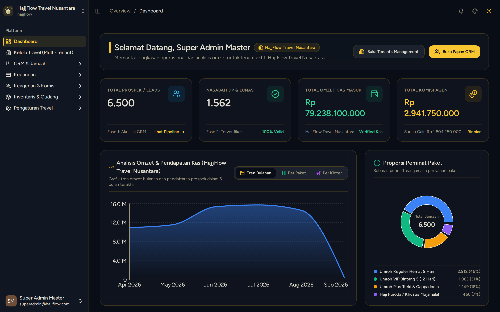

# Dashboard Utama & Ringkasan KPI Eksekutif

> **Target Peran**: `Owner (Level 1)` | **Login Akun**: `superadmin@hajjflow.com`
> **Tahapan Alur**: `1. Monitoring & Analitik Bisnis` | **Kategori**: `Eksekutif & Dashboard` | **Rute**: `/dashboard`

## 📋 Deskripsi Fitur
Pusat kendali eksekutif untuk melihat performa bisnis travel, total omzet masuk, sisa piutang, keterisian kuota jamaah, dan performa penjualan seluruh agen secara makro.

## 🖼️ Tampilan Antarmuka

## ⚡ Aksi & Fitur Lengkap (CRUD Matrix)

### 🔍 Read (Lihat / Pencarian / Filter Data)
- Melihat 4 Kartu KPI Utama: Total Jamaah, Akumulasi Omzet, Sisa Tagihan Jamaah, dan Jumlah Mitra Agen Aktif.
- Melihat grafik tren pendaftaran jamaah per bulan.
- Memantau daftar keberangkatan terdekat beserta status keterisian seat.

### ✨ Fitur Khusus & Otomasi
- Filter analitik berdasarkan rentang tanggal kustom.
- Ganti tema tampilan sistem (Luxury, Dark, Light, Emerald) melalui menu profil.

## 🛠️ Langkah-Langkah Penggunaan

1. Buka halaman login dan masukkan kredensial Owner (`superadmin@hajjflow.com`).
2. Periksa ringkasan angka pada kartu KPI di baris paling atas.
3. Analisis grafik tren pendaftaran untuk merencanakan promosi keberangkatan musim berikutnya.

---
*Buku Panduan Resmi Sistem Travel Umroh Multi-Tenant.*
