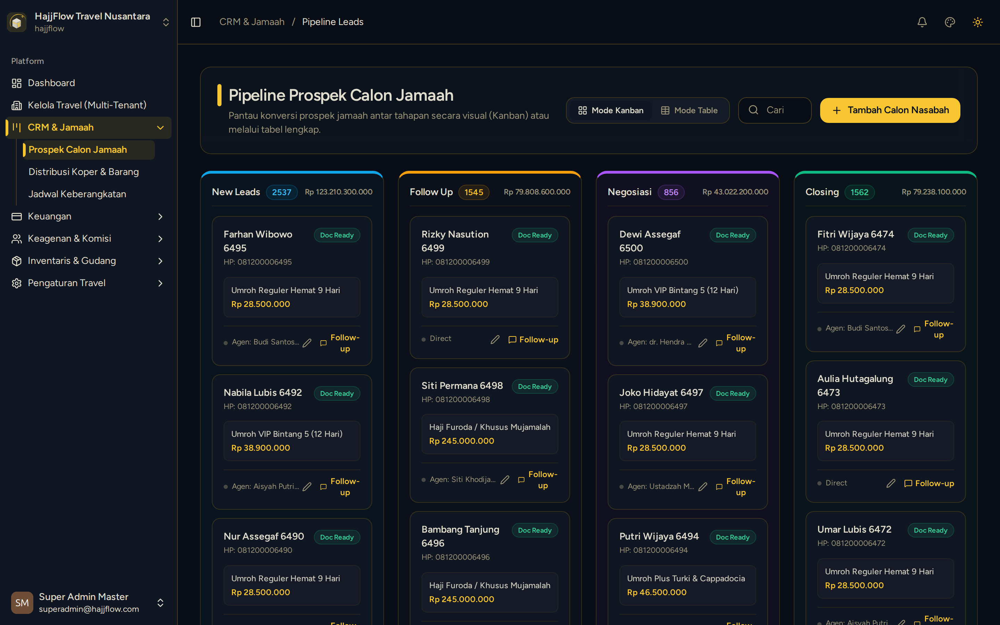

# Papan CRM Kanban Pipeline Jamaah (Leads to Closing)

> **Target Peran**: `Owner (Level 1)` | **Login Akun**: `superadmin@hajjflow.com`
> **Tahapan Alur**: `2. Pengawasan Pipa Penjualan` | **Kategori**: `CRM & Pipeline` | **Rute**: `/crm`

## 📋 Deskripsi Fitur
Papan visual Kanban untuk memantau pergerakan seluruh prospek jamaah dari tahap pendaftaran awal, verifikasi DP, kelengkapan paspor/visa, pelunasan, hingga siap berangkat.

## 🖼️ Tampilan Antarmuka

## ⚡ Aksi & Fitur Lengkap (CRUD Matrix)

### 🔍 Read (Lihat / Pencarian / Filter Data)
- Melihat kartu seluruh jamaah dari semua agen di masing-masing kolom tahapan.
- Filter jamaah berdasarkan Paket Keberangkatan atau Agen Perujuk.

### ✏️ Update (Edit / Pembaruan Status)
- Drag-and-drop kartu jamaah antar-kolom tahapan secara realtime.
- Klik kartu jamaah untuk membuka Laci Detail (Drawer) dan memperbarui data berkas.

### ✨ Fitur Khusus & Otomasi
- Sinkronisasi instan antar-perangkat saat status tahapan jamaah digeser.

## 🛠️ Langkah-Langkah Penggunaan

1. Masuk ke menu CRM > Pipeline Kanban.
2. Gunakan filter di bagian atas untuk menyaring jamaah per paket atau per agen.
3. Geser kartu jamaah ke kanan setelah jamaah menyelesaikan persyaratan tahapan (misal: DP Terbayar ➔ Berkas Paspor Lengkap).

---
*Buku Panduan Resmi Sistem Travel Umroh Multi-Tenant.*
