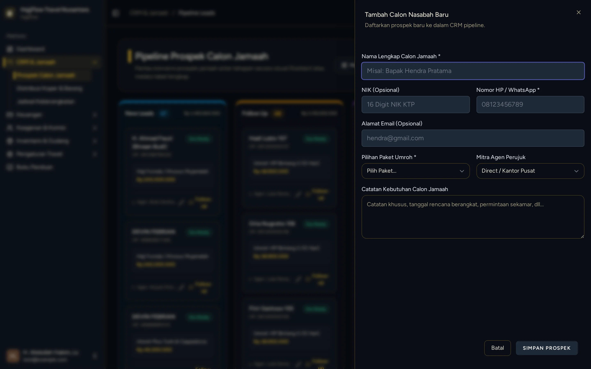

# Tambah Jamaah Baru Manual oleh Owner/Staf (CRM Create)

> **Target Peran**: `Owner (Level 1)` | **Login Akun**: `test@example.com`
> **Tahapan Alur**: `3. Pendaftaran Jamaah Manual` | **Kategori**: `CRM & Kasir` | **Rute / URL**: `/crm`

## 📋 Deskripsi Fitur
Owner atau staf kantor dapat mendaftarkan calon jamaah secara manual langsung dari papan CRM, misalnya untuk pendaftaran tatap muka, lewat telepon, atau pameran.

## 🖼️ Tampilan Antarmuka Utama

## 🗂️ Tampilan Drawer, Modal & Aksi Detail

### 📸 Tampilan Drawer

## ⚡ Aksi & Fitur Lengkap (CRUD Matrix)

### ➕ Create (Tambah / Input Baru)
- Klik tombol "+ Tambah Calon Nasabah" pada papan CRM.
- Isi formulir: Nama Lengkap, No HP/WhatsApp, Email, NIK KTP, Pilihan Paket Umroh, dan Agen Pembina (opsional).
- Klik Simpan — jamaah otomatis masuk ke stage "New Leads" di papan CRM Kanban.

### 🔍 Read (Lihat / Pencarian / Filter Data)
- Pencarian data jamaah berdasarkan Nama, Nomor Telepon/WhatsApp, NIK, atau Paket.
- Melihat riwayat log aktivitas dan prospek jamaah.

### ✏️ Update (Edit / Pembaruan Status)
- Klik tombol Edit Data untuk mengubah data pribadi, nomor paspor, atau paket yang dipilih.

### ✨ Fitur Khusus & Otomasi
- Otomatis terhubung dengan pipeline agen pembina jika dipilih.

## 🛠️ Langkah-Langkah Penggunaan

1. Login sebagai Owner, buka menu CRM > Pipeline Leads.
2. Klik tombol "+ Tambah Calon Nasabah" di pojok kanan atas.
3. Isi semua field yang wajib: Nama, No HP, NIK, dan pilih Paket Umroh.
4. Tentukan Agen Pembina jika calon jamaah direferensikan oleh agen tertentu.
5. Klik Simpan — jamaah baru langsung muncul di kolom New Leads.

## 💡 Tips & Catatan Penting

- 💡 Untuk mendaftarkan jamaah walk-in (hadir langsung ke kantor), gunakan fitur ini agar data langsung tercatat dan terintegrasi ke CRM agen.

---
*Buku Panduan Resmi Sistem Travel Umroh Multi-Tenant.*
