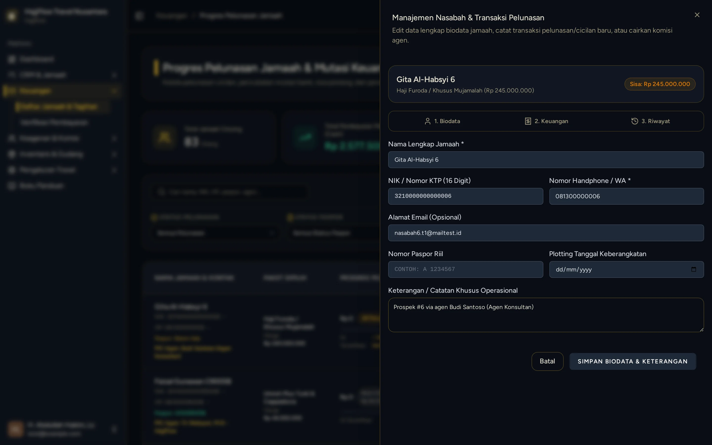

# Master Data Jamaah, Kasir & Kuitansi Pembayaran

> **Target Peran**: `Owner (Level 1)` | **Login Akun**: `test@example.com`
> **Tahapan Alur**: `3. Transaksi & Validasi Pembayaran` | **Kategori**: `CRM & Kasir` | **Rute / URL**: `/crm/customers`

## 📋 Deskripsi Fitur
Master data seluruh jamaah terdaftar dengan fungsi Kasir untuk memverifikasi pembayaran transfer bank, mencatat cicilan/pelunasan, dan menerbitkan invoice resmi.

## 🖼️ Tampilan Antarmuka Utama

## 🗂️ Tampilan Drawer, Modal & Aksi Detail

### 📸 Tampilan Drawer

## ⚡ Aksi & Fitur Lengkap (CRUD Matrix)

### ➕ Create (Tambah / Input Baru)
- Mencatat transaksi pelunasan, cicilan, atau uang muka jamaah secara langsung di tab keuangan.

### 🔍 Read (Lihat / Pencarian / Filter Data)
- Pencarian data jamaah berdasarkan Nama, Nomor Telepon/WhatsApp, NIK, atau Nomor Paspor.
- Melihat riwayat log pembayaran dan sisa tagihan per jamaah.

### ✏️ Update (Edit / Pembaruan Status)
- Klik tombol "Edit Data" untuk mengubah data pribadi, nomor paspor, kamar hotel, atau paket yang dipilih.
- Klik tombol "Rincian & Bayar" untuk membuka laci kasir keuangan.

### 🗑️ Delete (Hapus Data)
- Hapus data pendaftaran jamaah yang dibatalkan melalui opsi tindakan.

### ✨ Fitur Khusus & Otomasi
- Cetak Kuitansi Pembayaran & Invoice Digital Resmi bertanda tangan travel.

## 🛠️ Langkah-Langkah Penggunaan

1. Masuk ke menu CRM > Data Jamaah.
2. Cari nama jamaah yang melakukan transfer pembayaran.
3. Klik tombol "Edit Data" ➔ Lengkapi paspor dan data personal.
4. Klik tombol "Rincian & Bayar" ➔ Sistem menampilkan status Lunas atau Sisa Piutang.

---
*Buku Panduan Resmi Sistem Travel Umroh Multi-Tenant.*
