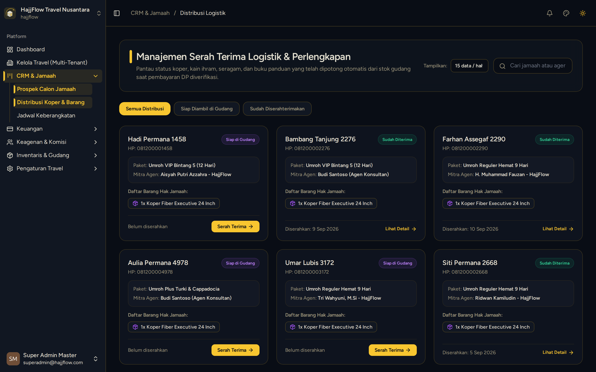

# Distribusi & Serah Terima Logistik Perlengkapan

> **Target Peran**: `Owner (Level 1)` | **Login Akun**: `superadmin@hajjflow.com`
> **Tahapan Alur**: `4. Eksekusi & Serah Terima Perlengkapan` | **Kategori**: `Operasional Gudang` | **Rute**: `/crm/logistics`

## 📋 Deskripsi Fitur
Modul serah terima barang perlengkapan ibadah (koper bagasi, kain ihram/mukena, buku doa, id card) kepada jamaah yang telah melunasi pembayaran.

## 🖼️ Tampilan Antarmuka

## ⚡ Aksi & Fitur Lengkap (CRUD Matrix)

### 🔍 Read (Lihat / Pencarian / Filter Data)
- Melihat daftar jamaah per jadwal keberangkatan beserta status kelengkapan perlengkapannya.

### ✏️ Update (Edit / Pembaruan Status)
- Centang (checklist) item perlengkapan yang diserahkan fisik kepada jamaah.
- Simpan status serah terima barang secara realtime.

### ✨ Fitur Khusus & Otomasi
- Otomatis memotong jumlah stok fisik di modul Inventaris Gudang saat item dicentang.

## 🛠️ Langkah-Langkah Penggunaan

1. Buka menu CRM > Logistik Jamaah.
2. Pilih paket keberangkatan yang sedang dipersiapkan.
3. Centang item yang diserahkan ke jamaah (misal: Koper, Batik, Kain Ihram).
4. Klik Simpan untuk memperbarui rekaman logistik.

---
*Buku Panduan Resmi Sistem Travel Umroh Multi-Tenant.*
