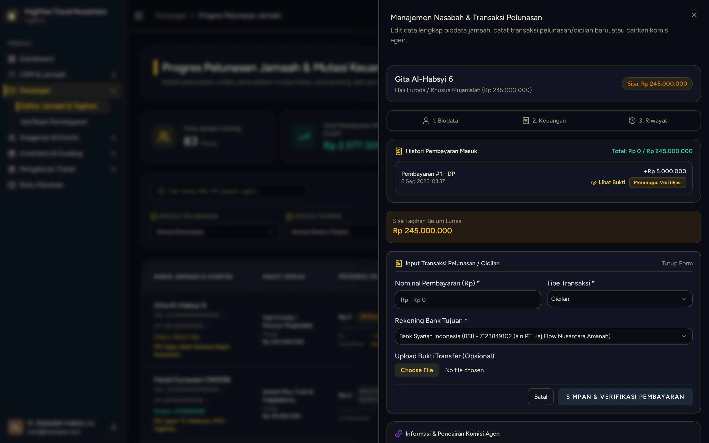

# Input Pembayaran DP Jamaah oleh Owner/Kasir

> **Target Peran**: `Owner (Level 1)` | **Login Akun**: `test@example.com`
> **Tahapan Alur**: `3. Transaksi & Validasi Pembayaran` | **Kategori**: `CRM & Kasir` | **Rute / URL**: `/crm/customers`

## 📋 Deskripsi Fitur
Kasir atau Owner memasukkan penerimaan uang muka (Down Payment / DP) jamaah ke dalam sistem setelah konfirmasi transfer bank diterima. Nominal DP bisa berapa saja sesuai kebijakan travel.

## 🖼️ Tampilan Antarmuka Utama

## 🗂️ Tampilan Drawer, Modal & Aksi Detail

### 📸 Tampilan Drawer

## ⚡ Aksi & Fitur Lengkap (CRUD Matrix)

### ➕ Create (Tambah / Input Baru)
- Buka laci detail jamaah ➔ klik tombol "Rincian & Bayar" ➔ klik "Catat Pelunasan / Cicilan".
- Pilih Tipe Pembayaran: **DP** (uang muka).
- Isi Nominal DP yang ditransfer jamaah.
- Pilih Rekening Bank Tujuan (rekening travel yang digunakan jamaah).
- Unggah foto/scan Bukti Transfer.
- Klik Simpan — saldo tagihan jamaah otomatis berkurang.

### 🔍 Read (Lihat / Pencarian / Filter Data)
- Riwayat semua pembayaran jamaah tersusun kronologis di bagian bawah halaman detail.

### ✨ Fitur Khusus & Otomasi
- Sistem menghitung otomatis Sisa Tagihan = Harga Paket − Total Pembayaran Masuk.

## 🛠️ Langkah-Langkah Penggunaan

1. Buka CRM > Data Jamaah, cari nama jamaah yang mentransfer DP.
2. Klik tombol "Rincian & Bayar" pada baris jamaah.
3. Klik tombol "Catat Pelunasan / Cicilan" jika masih ada sisa tagihan.
4. Pilih tipe "DP", isi nominal, pilih rekening, unggah bukti transfer.
5. Klik Simpan — status pembayaran jamaah terupdate dan sisa tagihan berkurang.

## 💡 Tips & Catatan Penting

- 💡 Satu jamaah dapat memiliki beberapa transaksi DP (cicilan), semuanya terakumulasi otomatis oleh sistem.

---
*Buku Panduan Resmi Sistem Travel Umroh Multi-Tenant.*
