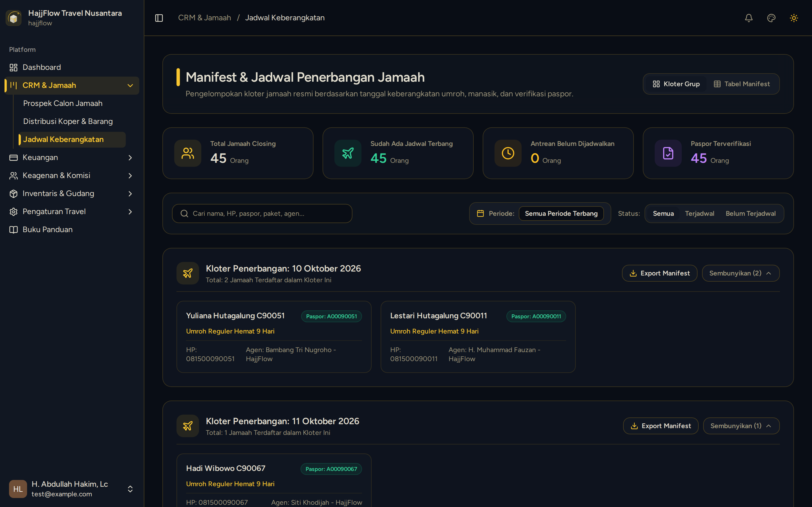

# Jadwal, Maskapai & Manajemen Kuota Kursi

> **Target Peran**: `Owner (Level 1)` | **Login Akun**: `superadmin@hajjflow.com`
> **Tahapan Alur**: `4. Manajemen Kloter & Kuota Seat` | **Kategori**: `Operasional` | **Rute / URL**: `/crm/schedules`

## 📋 Deskripsi Fitur
Manajemen kloter keberangkatan, batas kuota kursi pesawat, hotel Makkah/Madinah, dan status ketersediaan seat.

## 🖼️ Tampilan Antarmuka

## ⚡ Aksi & Fitur Lengkap (CRUD Matrix)

### ➕ Create (Tambah / Input Baru)
- Klik "Tambah Jadwal" untuk membuka kloter keberangkatan musim baru dengan tanggal, maskapai, dan kuota tertentu.

### 🔍 Read (Lihat / Pencarian / Filter Data)
- Melihat persentase keterisian kursi (Seat Occupancy) per tanggal keberangkatan.

### ✏️ Update (Edit / Pembaruan Status)
- Ubah tanggal terbang, ganti maskapai penerbangan, atau tambah batas kuota kursi.

### 🗑️ Delete (Hapus Data)
- Hapus jadwal keberangkatan yang belum memiliki jamaah terdaftar.

## 🛠️ Langkah-Langkah Penggunaan

1. Buka menu CRM > Jadwal Keberangkatan.
2. Periksa sisa kuota kursi pada paket umroh musim aktif.
3. Gunakan tombol "+ Tambah Jadwal" jika ingin membuka tanggal keberangkatan baru.

---
*Buku Panduan Resmi Sistem Travel Umroh Multi-Tenant.*
