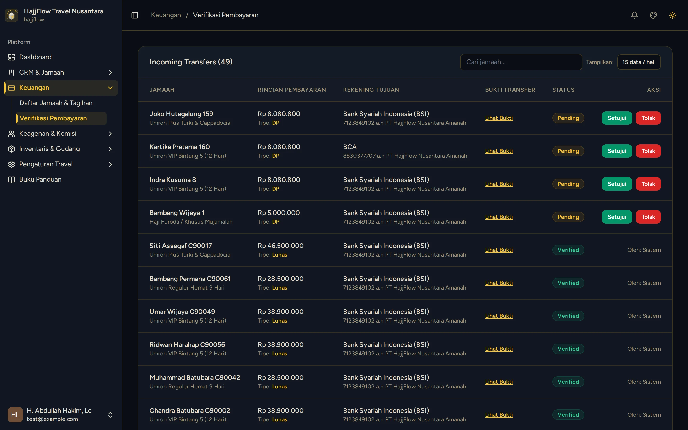
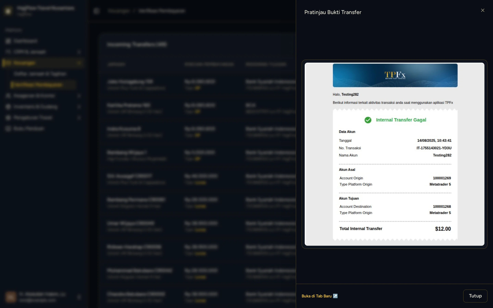

# Verifikasi & Persetujuan Bukti Transfer (Finance)

> **Target Peran**: `Owner (Level 1)` | **Login Akun**: `test@example.com`
> **Tahapan Alur**: `3. Transaksi & Validasi Pembayaran` | **Kategori**: `Keuangan & Verifikasi` | **Rute / URL**: `/finance/payment`

## 📋 Deskripsi Fitur
Halaman Finance Payment adalah pusat validasi kasir untuk menyetujui atau menolak bukti transfer yang diunggah jamaah atau agen. Setelah diverifikasi, dana dianggap masuk resmi ke kas travel.

## 🖼️ Tampilan Antarmuka Utama

## 🗂️ Tampilan Drawer, Modal & Aksi Detail

### 📸 Tampilan Pratinjau Bukti

## ⚡ Aksi & Fitur Lengkap (CRUD Matrix)

### 🔍 Read (Lihat / Pencarian / Filter Data)
- Melihat semua pengajuan pembayaran dengan status Pending Verifikasi yang menunggu konfirmasi.
- Klik "Lihat Bukti" untuk membuka pratinjau lembar foto/scan transfer bank asli.

### ✏️ Update (Edit / Pembaruan Status)
- Klik tombol "Setujui" untuk mengesahkan pembayaran — status berubah ke Verified.
- Klik tombol "Tolak" jika bukti transfer tidak valid atau dana belum masuk rekening.

### ✨ Fitur Khusus & Otomasi
- Setelah diverifikasi, komisi agen terkait otomatis berstatus Eligible (siap dicairkan).
- Jamaah yang sudah Lunas total otomatis pindah ke stage Closing di Kanban CRM.

## 🛠️ Langkah-Langkah Penggunaan

1. Login sebagai Owner, buka menu Finance > Verifikasi Pembayaran.
2. Cari baris pembayaran dengan status "Pending" (belum diverifikasi).
3. Klik tombol "Lihat Bukti" untuk melihat pratinjau bukti transfer.
4. Konfirmasi kesesuaian nominal dengan mutasi bank travel.
5. Klik tombol "Setujui" — status berubah menjadi Verified dan sistem memproses komisi agen secara otomatis.

## 💡 Tips & Catatan Penting

- 💡 Selalu cocokkan nominal yang tertera di bukti transfer dengan mutasi rekening bank resmi sebelum menyetujui.

---
*Buku Panduan Resmi Sistem Travel Umroh Multi-Tenant.*
