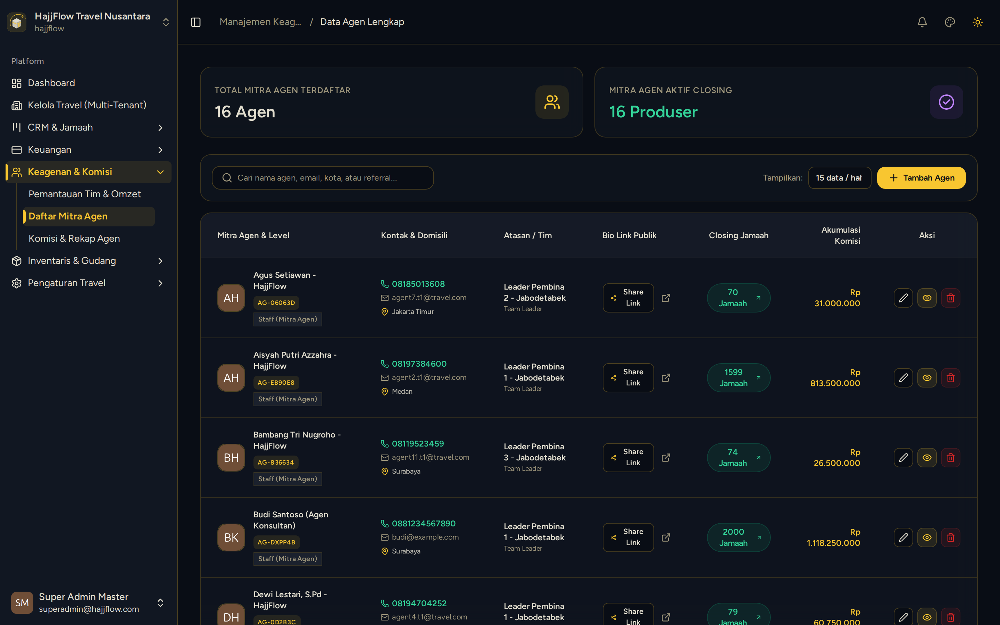

# Manajemen Mitra Agen & Persetujuan Akun

> **Target Peran**: `Owner (Level 1)` | **Login Akun**: `superadmin@hajjflow.com`
> **Tahapan Alur**: `5. Tata Kelola Mitra Penjualan` | **Kategori**: `Keagenan & Kemitraan` | **Rute**: `/agents`

## 📋 Deskripsi Fitur
Pusat pengelolaan mitra agen travel, pembuatan akun agen baru, verifikasi persetujuan kemitraan, dan pengaturan kode referral.

## 🖼️ Tampilan Antarmuka

## ⚡ Aksi & Fitur Lengkap (CRUD Matrix)

### ➕ Create (Tambah / Input Baru)
- Klik "+ Tambah Agen" untuk mendaftarkan mitra agen / konsultan baru langsung dari kantor pusat.

### 🔍 Read (Lihat / Pencarian / Filter Data)
- Melihat daftar seluruh agen, total perolehan jamaah binaan, dan nomor kontak WhatsApp aktif.

### ✏️ Update (Edit / Pembaruan Status)
- Edit data profil agen, ganti nomor telepon, atau ubah status persetujuan akun (Active/Suspended).

### 🗑️ Delete (Hapus Data)
- Hapus akun kemitraan agen yang sudah tidak aktif.

## 🛠️ Langkah-Langkah Penggunaan

1. Buka menu Keagenan > Daftar Mitra Agen.
2. Verifikasi data agen yang baru bergabung dan pastikan statusnya Aktif.
3. Salin Kode Referral unik agen untuk konfirmasi.

---
*Buku Panduan Resmi Sistem Travel Umroh Multi-Tenant.*
