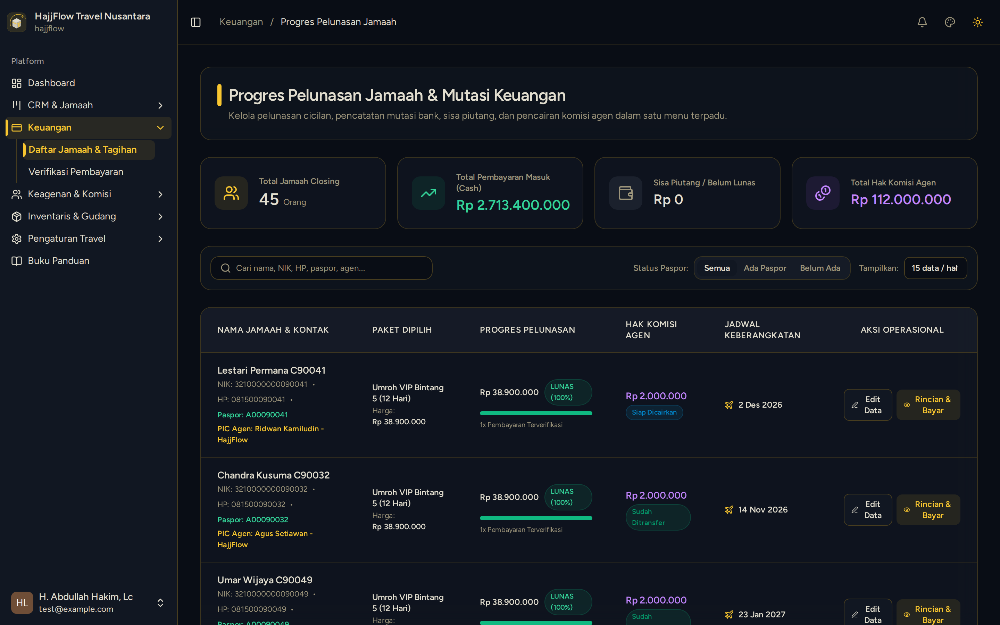
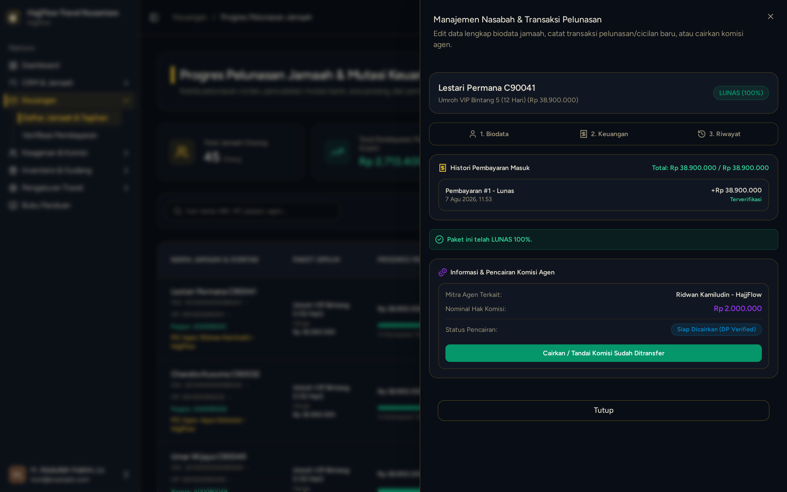

# Input Pelunasan Penuh (Lunas) Jamaah oleh Kasir

> **Target Peran**: `Owner (Level 1)` | **Login Akun**: `test@example.com`
> **Tahapan Alur**: `3. Transaksi & Validasi Pembayaran` | **Kategori**: `CRM & Kasir` | **Rute / URL**: `/crm/customers`

## 📋 Deskripsi Fitur
Proses pencatatan pelunasan akhir jamaah saat total pembayaran telah memenuhi harga paket. Sistem otomatis memindahkan jamaah ke stage Closing dan menerbitkan notifikasi komisi agen.

## 🖼️ Tampilan Antarmuka Utama

## 🗂️ Tampilan Drawer, Modal & Aksi Detail

### 📸 Tampilan Drawer

## ⚡ Aksi & Fitur Lengkap (CRUD Matrix)

### ➕ Create (Tambah / Input Baru)
- Buka laci kasir jamaah ➔ klik "Catat Pelunasan / Cicilan".
- Pilih Tipe Pembayaran: **Pelunasan**.
- Sistem mendeteksi jika total pembayaran = harga paket ➔ status otomatis berubah menjadi **LUNAS (100%)**.

### ✨ Fitur Khusus & Otomasi
- Komisi agen otomatis berpindah ke status Ready_to_Pay setelah lunas terverifikasi.
- Notifikasi dikirim ke dashboard agen bahwa jamaah binaan telah lunas.

## 🛠️ Langkah-Langkah Penggunaan

1. Buka CRM > Data Jamaah ➔ cari jamaah yang akan dilunasi.
2. Klik tombol "Rincian & Bayar" pada baris jamaah.
3. Input sisa nominal pelunasan, pilih rekening, dan unggah bukti transfer terakhir.
4. Klik Simpan ➔ sistem otomatis menandai jamaah sebagai Lunas.
5. Buka Finance > Verifikasi Pembayaran ➔ setujui bukti pelunasan.
6. Jamaah otomatis berpindah ke kolom Closing di papan CRM Kanban.

---
*Buku Panduan Resmi Sistem Travel Umroh Multi-Tenant.*
