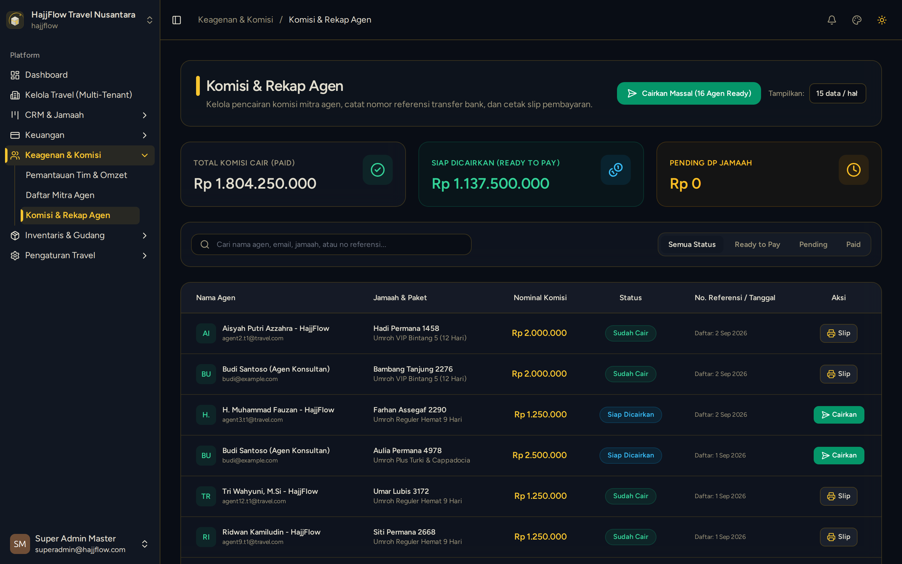

# Rekapitulasi & Pencairan Komisi Mitra Agen

> **Target Peran**: `Owner (Level 1)` | **Login Akun**: `superadmin@hajjflow.com`
> **Tahapan Alur**: `6. Payout & Pembagian Hasil` | **Kategori**: `Keuangan & Komisi` | **Rute**: `/commissions`

## 📋 Deskripsi Fitur
Modul rekapitulasi dan pembayaran komisi mitra agen yang jamaahnya telah menyelesaikan pelunasan pembayaran paket.

## 🖼️ Tampilan Antarmuka

## ⚡ Aksi & Fitur Lengkap (CRUD Matrix)

### 🔍 Read (Lihat / Pencarian / Filter Data)
- Melihat daftar komisi pending (belum lunas) dan komisi yang siap dicairkan.
- Audit perolehan komisi langsung per jamaah dan komisi override leader.

### ✏️ Update (Edit / Pembaruan Status)
- Klik "Cairkan Komisi" setelah mentransfer hak komisi ke rekening bank agen.

### ✨ Fitur Khusus & Otomasi
- Unggah bukti transfer perbankan sebagai rekaman audit keuangan resmi.

## 🛠️ Langkah-Langkah Penggunaan

1. Buka menu Keagenan > Komisi Agen.
2. Filter daftar komisi dengan status "Siap Cair".
3. Lakukan transfer ke rekening agen ➔ Klik tombol "Cairkan Komisi" dan lampirkan referensi transfer.

---
*Buku Panduan Resmi Sistem Travel Umroh Multi-Tenant.*
