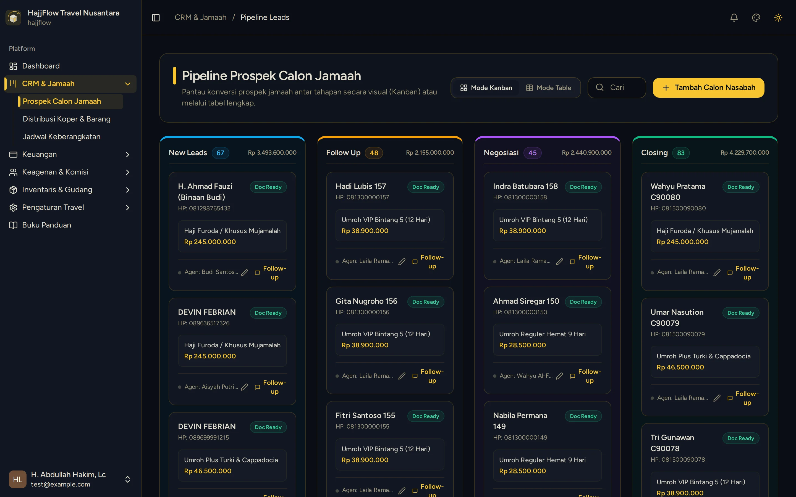
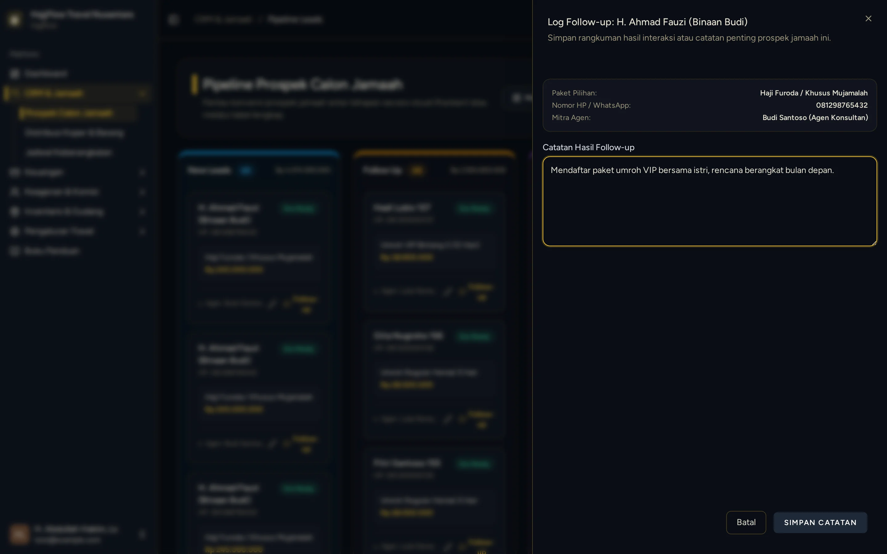

# Memindahkan Stage Jamaah di Papan Kanban CRM

> **Target Peran**: `Owner (Level 1)` | **Login Akun**: `test@example.com`
> **Tahapan Alur**: `2. Pengawalan Leads & Prospek` | **Kategori**: `CRM & Penjualan` | **Rute / URL**: `/crm`

## 📋 Deskripsi Fitur
Owner dapat menggeser kartu jamaah antar-kolom tahapan CRM (New Leads → Follow Up → Negosiasi → Closing) baik secara drag & drop maupun via tombol follow-up dan edit.

## 🖼️ Tampilan Antarmuka Utama

## 🗂️ Tampilan Drawer, Modal & Aksi Detail

### 📸 Tampilan Modal Followup

## ⚡ Aksi & Fitur Lengkap (CRUD Matrix)

### 🔍 Read (Lihat / Pencarian / Filter Data)
- Lihat jumlah jamaah per stage di header setiap kolom.
- Filter kartu berdasarkan nama, nomor HP, paket, atau agen.

### ✏️ Update (Edit / Pembaruan Status)
- Drag & Drop kartu jamaah dari kolom satu ke kolom berikutnya secara langsung.
- Atau klik tombol Follow-up pada kartu jamaah untuk mencatat progres negosiasi.
- Setiap perpindahan stage tercatat otomatis di log aktivitas jamaah.

## 🛠️ Langkah-Langkah Penggunaan

1. Buka menu CRM > Pipeline Leads.
2. Temukan kartu jamaah yang ingin dipindahkan stagenya.
3. Seret (drag) kartu ke kolom stage yang baru atau klik tombol Follow-up.
4. Konfirmasi perpindahan — log stage otomatis terupdate di histori jamaah.

## 💡 Tips & Catatan Penting

- 💡 Perpindahan dari stage Negosiasi ke Closing hanya bisa dilakukan setelah ada minimal satu pembayaran yang sudah terverifikasi.

---
*Buku Panduan Resmi Sistem Travel Umroh Multi-Tenant.*
