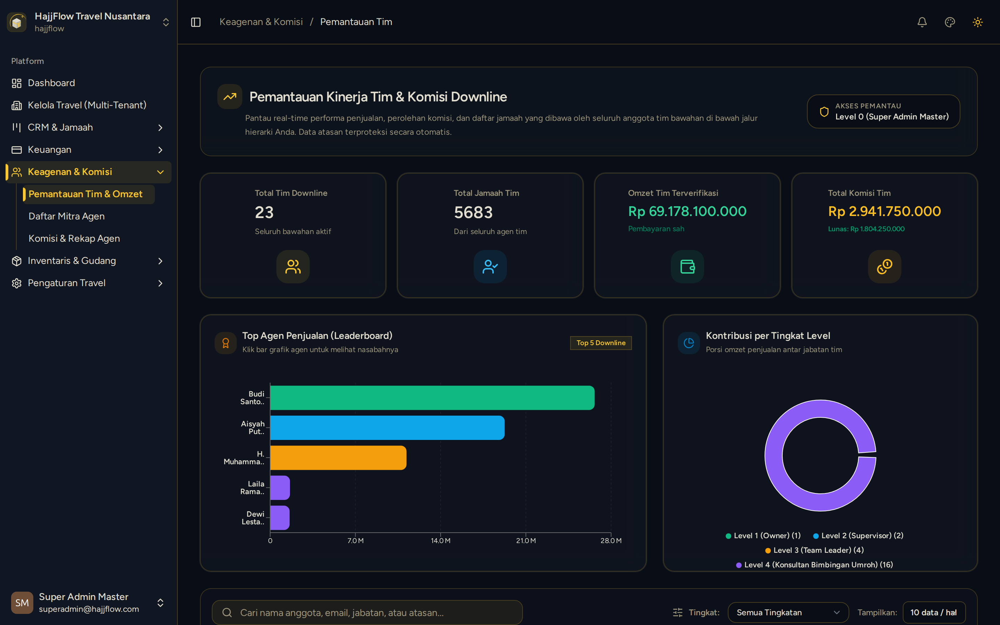

# Monitoring Struktur Tim & Pohon Jaringan Agen

> **Target Peran**: `Owner (Level 1)` | **Login Akun**: `superadmin@hajjflow.com`
> **Tahapan Alur**: `2. Pengawasan Jaringan Penjualan` | **Kategori**: `Keagenan & MLM Syariah` | **Rute / URL**: `/monitoring`

## 📋 Deskripsi Fitur
Visualisasi pohon jaringan (Network Tree) keagenan bertingkat untuk melihat hubungan Upline-Downline, struktur Leader, dan perolehan omzet grup.

## 🖼️ Tampilan Antarmuka

## ⚡ Aksi & Fitur Lengkap (CRUD Matrix)

### 🔍 Read (Lihat / Pencarian / Filter Data)
- Melihat diagram pohon organisasi agen dari tingkat Cabang, Leader Pembina, hingga Agen Konsultan.
- Melihat total omzet grup dan kontribusi jamaah per cabang.

## 🛠️ Langkah-Langkah Penggunaan

1. Buka menu Keagenan > Monitoring Tim.
2. Klik pada nama Leader untuk membuka bagan rantai downline di bawahnya.

---
*Buku Panduan Resmi Sistem Travel Umroh Multi-Tenant.*
