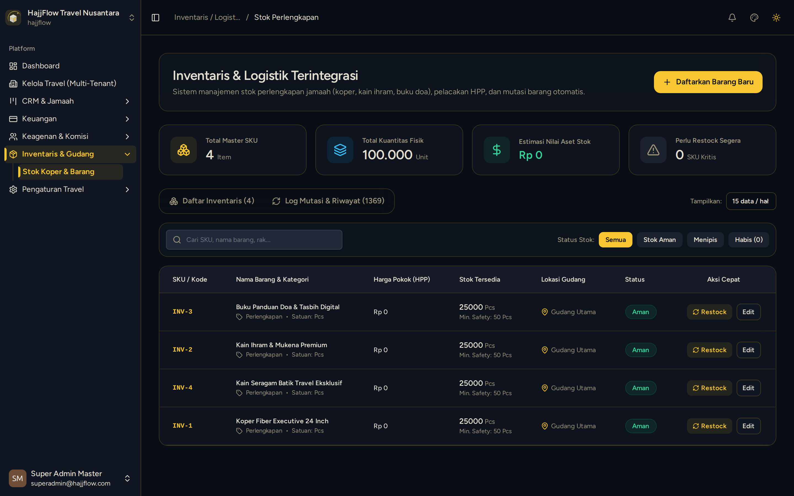

# Inventaris Stok Fisik Gudang & Barang Masuk

> **Target Peran**: `Owner (Level 1)` | **Login Akun**: `superadmin@hajjflow.com`
> **Tahapan Alur**: `4. Eksekusi & Serah Terima Perlengkapan` | **Kategori**: `Gudang & Inventaris` | **Rute / URL**: `/inventaris`

## 📋 Deskripsi Fitur
Pencatatan persediaan fisik perlengkapan travel di gudang (koper, kain ihram, mukena, seragam) beserta riwayat barang masuk dari vendor.

## 🖼️ Tampilan Antarmuka

## ⚡ Aksi & Fitur Lengkap (CRUD Matrix)

### ➕ Create (Tambah / Input Baru)
- Klik "Tambah Barang Masuk" saat menerima pengiriman stok baru dari vendor konveksi/pabrik.

### 🔍 Read (Lihat / Pencarian / Filter Data)
- Cek saldo stok fisik terkini dan peringatan stok menipis (*Low Stock Alert*).

### ✏️ Update (Edit / Pembaruan Status)
- Penyesuaian stok (*Stock Opname*) untuk koreksi jumlah barang fisik.

## 🛠️ Langkah-Langkah Penggunaan

1. Buka menu Inventaris > Stok Perlengkapan.
2. Periksa jumlah stok pada tabel inventaris.
3. Klik tombol "Tambah Barang Masuk" untuk menambah kuantiti stok yang baru diterima.

---
*Buku Panduan Resmi Sistem Travel Umroh Multi-Tenant.*
