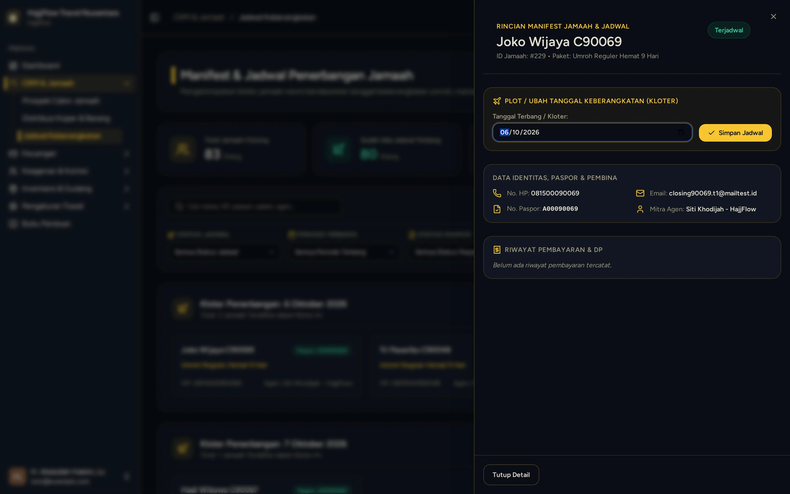

# Jadwal, Maskapai & Manajemen Kuota Kursi

> **Target Peran**: `Owner (Level 1)` | **Login Akun**: `test@example.com`
> **Tahapan Alur**: `4. Manajemen Kloter & Kuota Seat` | **Kategori**: `Operasional` | **Rute / URL**: `/crm/schedules`

## 📋 Deskripsi Fitur
Manajemen kloter keberangkatan, batas kuota kursi pesawat, hotel Makkah/Madinah, dan status ketersediaan seat.

## 🖼️ Tampilan Antarmuka Utama

## 🗂️ Tampilan Drawer, Modal & Aksi Detail

### 📸 Tampilan Drawer Manifest

## ⚡ Aksi & Fitur Lengkap (CRUD Matrix)

### ➕ Create (Tambah / Input Baru)
- Plot tanggal terbang jamaah ke jadwal kloter keberangkatan baru.

### 🔍 Read (Lihat / Pencarian / Filter Data)
- Melihat persentase keterisian kursi (Seat Occupancy) per tanggal keberangkatan.
- Buka laci detail manifest jamaah untuk memeriksa status paspor dan penerbangan.

### ✏️ Update (Edit / Pembaruan Status)
- Ubah tanggal terbang, jadwalkan ulang (reschedule) jamaah, atau export manifest CSV.

## 🛠️ Langkah-Langkah Penggunaan

1. Buka menu CRM > Jadwal Keberangkatan.
2. Periksa sisa kuota kursi pada paket umroh musim aktif.
3. Klik kartu jamaah untuk membuka laci rincian manifest dan mengatur jadwal terbang.

---
*Buku Panduan Resmi Sistem Travel Umroh Multi-Tenant.*
