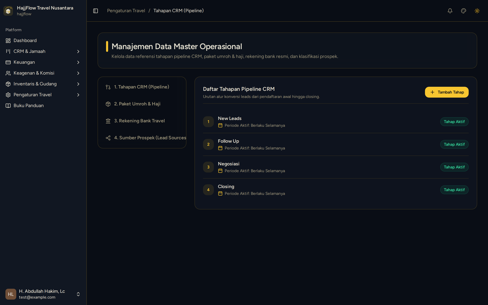

# Pengaturan Master Paket, Rekening & CRM

> **Target Peran**: `Owner (Level 1)` | **Login Akun**: `superadmin@hajjflow.com`
> **Tahapan Alur**: `1. Setup & Konfigurasi Awal` | **Kategori**: `Master Data` | **Rute / URL**: `/settings/master`

## 📋 Deskripsi Fitur
Konfigurasi sentral paket umroh & haji, nominal komisi default, fasilitas hotel, rekening bank resmi penerima dana, dan sumber prospek leads.

## 🖼️ Tampilan Antarmuka

## ⚡ Aksi & Fitur Lengkap (CRUD Matrix)

### ➕ Create (Tambah / Input Baru)
- Tambah Paket Umroh baru (Harga, Komisi Agen, Kuota, Fasilitas).
- Tambah Rekening Bank Resmi Travel (BCA, BSI, Mandiri, dll).
- Tambah Sumber Prospek (Instagram Ads, Brosur, Pengajian, Walk-In).

### 🔍 Read (Lihat / Pencarian / Filter Data)
- Melihat seluruh katalog paket, rekening aktif, dan tahapan pipeline CRM.

### ✏️ Update (Edit / Pembaruan Status)
- Ubah harga paket, edit fasilitas hotel, atau update nama tahapan CRM.

### 🗑️ Delete (Hapus Data)
- Hapus paket atau rekening yang sudah tidak digunakan.

## 🛠️ Langkah-Langkah Penggunaan

1. Buka menu Pengaturan > Data Master.
2. Tab "Paket Umroh": Atur paket-paket yang akan dijual agen beserta besaran komisi mitra.
3. Tab "Rekening Bank": Masukkan nomor rekening resmi travel yang akan muncul di formulir pembayaran jamaah.

---
*Buku Panduan Resmi Sistem Travel Umroh Multi-Tenant.*
