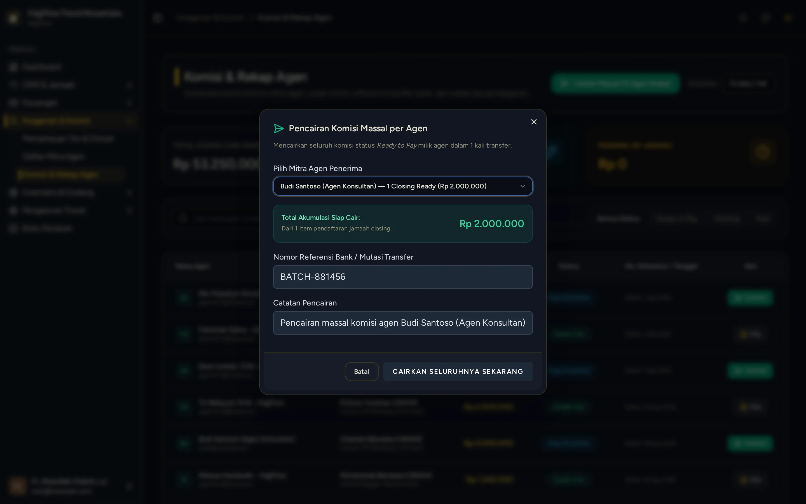

# Rekapitulasi & Pencairan Komisi Mitra Agen

> **Target Peran**: `Owner (Level 1)` | **Login Akun**: `test@example.com`
> **Tahapan Alur**: `6. Validasi & Pembayaran Komisi` | **Kategori**: `Keuangan & Komisi` | **Rute / URL**: `/commissions`

## 📋 Deskripsi Fitur
Modul keuangan untuk memvalidasi hak komisi penjualan agen atas jamaah yang telah lunas dan memproses pencairan transfer dana ke rekening bank agen.

## 🖼️ Tampilan Antarmuka Utama

## 🗂️ Tampilan Drawer, Modal & Aksi Detail

### 📸 Tampilan Modal Batch Payout

## ⚡ Aksi & Fitur Lengkap (CRUD Matrix)

### 🔍 Read (Lihat / Pencarian / Filter Data)
- Melihat daftar komisi per transaksi jamaah dengan status: Pending, Siap Dicairkan (*Eligible*), atau Selesai Ditransfer (*Paid*).

### ✏️ Update (Edit / Pembaruan Status)
- Ubah status komisi individual menjadi "Paid" setelah bukti transfer diunggah.

### ✨ Fitur Khusus & Otomasi
- Fitur **Batch Payout**: Cairkan komisi banyak agen sekaligus dengan sekali centang dan satu klik validasi.
- Ekspor rekapitulasi pencairan komisi ke format Excel/PDF untuk arsip akuntansi.

## 🛠️ Langkah-Langkah Penggunaan

1. Buka menu Keagenan > Pembagian Komisi.
2. Pilih baris komisi yang berstatus "Siap Dicairkan".
3. Klik tombol "Cairkan Massal" atau klik "Cairkan" pada baris komisi.
4. Simpan status pembayaran ➔ Notifikasi terkirim ke dashboard agen.

---
*Buku Panduan Resmi Sistem Travel Umroh Multi-Tenant.*
