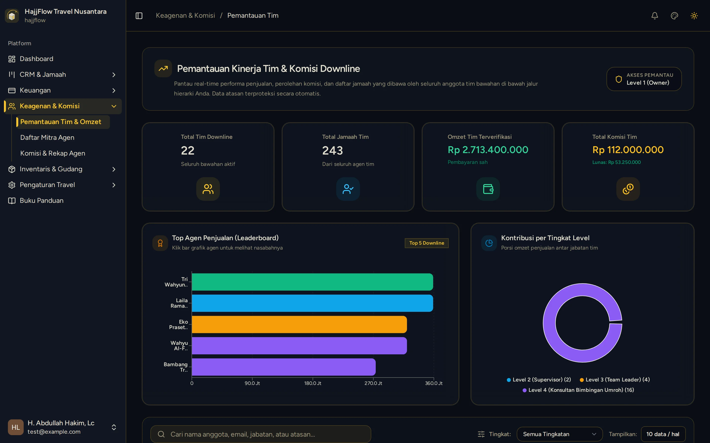
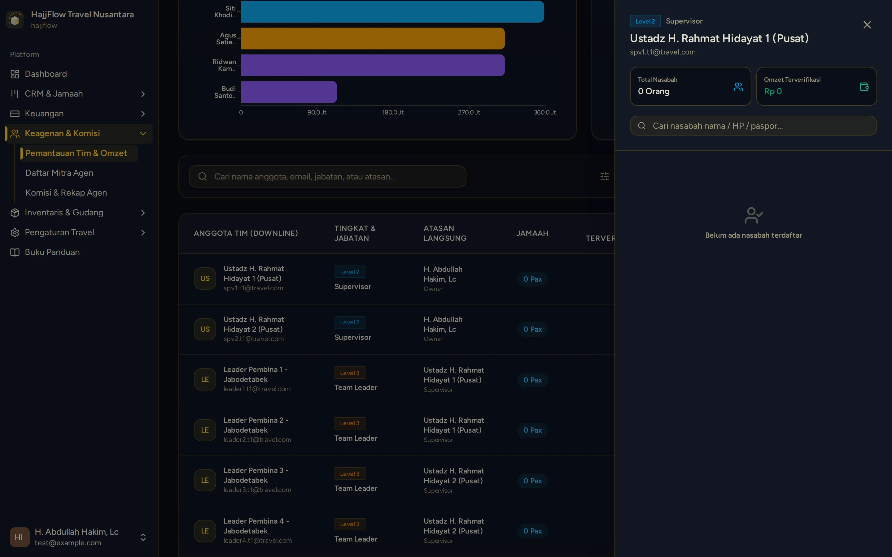

# Monitoring Struktur Tim & Pohon Jaringan Agen

> **Target Peran**: `Owner (Level 1)` | **Login Akun**: `test@example.com`
> **Tahapan Alur**: `2. Pengawasan Jaringan Penjualan` | **Kategori**: `Keagenan & MLM Syariah` | **Rute / URL**: `/monitoring`

## 📋 Deskripsi Fitur
Visualisasi pohon jaringan (Network Tree) keagenan bertingkat untuk melihat hubungan Upline-Downline, struktur Leader, dan perolehan omzet grup.

## 🖼️ Tampilan Antarmuka Utama

## 🗂️ Tampilan Drawer, Modal & Aksi Detail

### 📸 Tampilan Drawer Nasabah Tim

## ⚡ Aksi & Fitur Lengkap (CRUD Matrix)

### 🔍 Read (Lihat / Pencarian / Filter Data)
- Melihat diagram hierarki dan distribusi anggota tim per tingkat.
- Klik "Lihat Nasabah" pada baris anggota tim untuk membuka laci daftar jamaah binaannya secara detail.

## 🛠️ Langkah-Langkah Penggunaan

1. Buka menu Keagenan > Monitoring Tim.
2. Pantau kontribusi omzet dan total jamaah per anggota.
3. Klik tombol "Lihat Nasabah" pada anggota tim untuk melihat daftar jamaah yang dibinanya.

---
*Buku Panduan Resmi Sistem Travel Umroh Multi-Tenant.*
