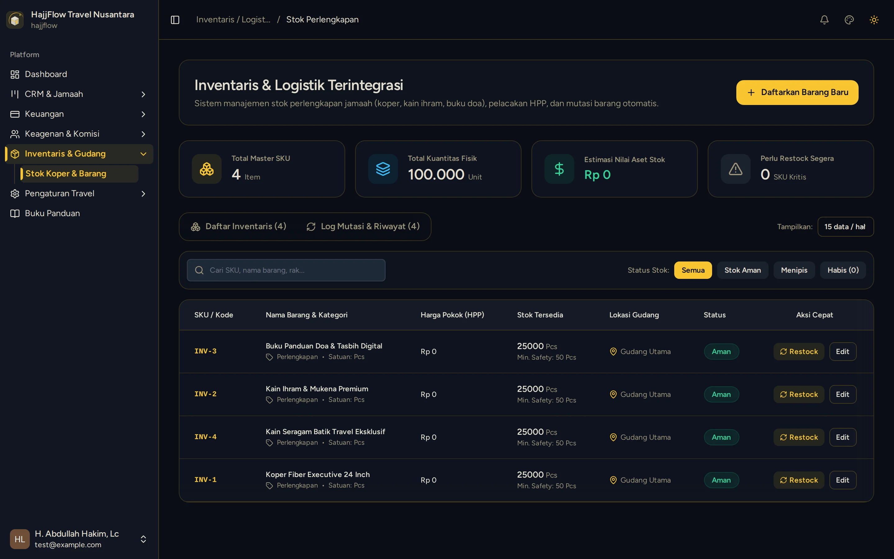
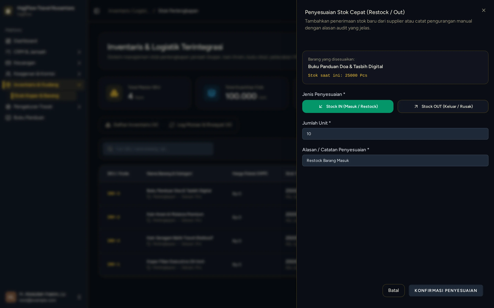
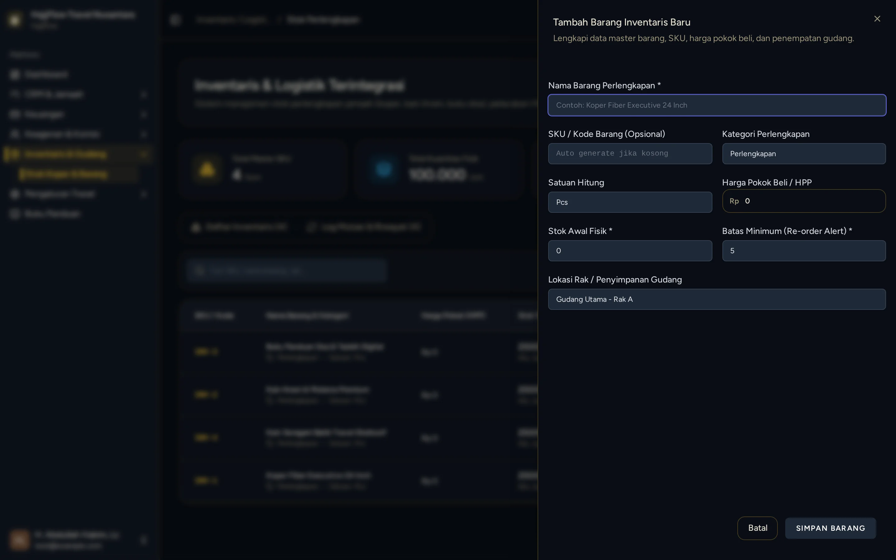

# Inventaris Stok Fisik Gudang & Barang Masuk

> **Target Peran**: `Owner (Level 1)` | **Login Akun**: `test@example.com`
> **Tahapan Alur**: `4. Eksekusi & Serah Terima Perlengkapan` | **Kategori**: `Gudang & Inventaris` | **Rute / URL**: `/inventaris`

## 📋 Deskripsi Fitur
Pencatatan persediaan fisik perlengkapan travel di gudang (koper, kain ihram, mukena, seragam) beserta riwayat barang masuk dari vendor.

## 🖼️ Tampilan Antarmuka Utama

## 🗂️ Tampilan Drawer, Modal & Aksi Detail

### 📸 Tampilan Sheet Restock

### 📸 Tampilan Sheet Tambah Barang

## ⚡ Aksi & Fitur Lengkap (CRUD Matrix)

### ➕ Create (Tambah / Input Baru)
- Klik "Daftarkan Barang Baru" untuk memasukkan item inventaris perlengkapan baru.
- Klik "Restock" pada baris barang untuk mencatat penyesuaian stok masuk (Stock IN).

### 🔍 Read (Lihat / Pencarian / Filter Data)
- Cek saldo stok fisik terkini dan peringatan stok menipis (*Low Stock Alert*).

### ✏️ Update (Edit / Pembaruan Status)
- Penyesuaian stok (*Stock Opname*) untuk koreksi jumlah barang fisik.

## 🛠️ Langkah-Langkah Penggunaan

1. Buka menu Inventaris > Stok Perlengkapan.
2. Klik tombol "+ Daftarkan Barang Baru" untuk registrasi barang baru.
3. Klik tombol "Restock" pada baris barang untuk menambah stok masuk dari vendor.

---
*Buku Panduan Resmi Sistem Travel Umroh Multi-Tenant.*
