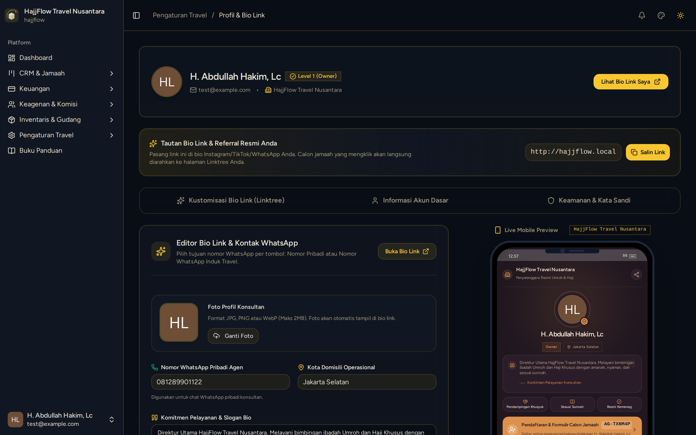

# Profil Akun, Tema & Keamanan Owner

> **Target Peran**: `Owner (Level 1)` | **Login Akun**: `test@example.com`
> **Tahapan Alur**: `1. Setup & Konfigurasi Akun` | **Kategori**: `Profil & Keamanan` | **Rute / URL**: `/profile`

## 📋 Deskripsi Fitur
Pengaturan profil personal direksi/owner travel, pembaruan kata sandi akun demi keamanan data, dan pengaturan preferensi tema tampilan antarmuka (Luxury, Emerald, Light, Dark).

## 🖼️ Tampilan Antarmuka Utama

## ⚡ Aksi & Fitur Lengkap (CRUD Matrix)

### 🔍 Read (Lihat / Pencarian / Filter Data)
- Melihat identitas profil login, email resmi, dan status tingkat akun Superadmin/Owner.

### ✏️ Update (Edit / Pembaruan Status)
- Perbarui Nama Lengkap dan Alamat Email resmi.
- Ganti Kata Sandi / Password login akun Owner.
- Pilih Tema Warna Aplikasi (Coffee Luxury, Emerald Syariah, Classic Light, Modern Dark).

### ✨ Fitur Khusus & Otomasi
- Pergantian tema langsung diterapkan secara instan (*realtime live theme switch*).

## 🛠️ Langkah-Langkah Penggunaan

1. Klik avatar/nama pengguna di pojok kanan atas ➔ Pilih "Profile".
2. Pada bagian Informasi Profil, perbarui data nama atau email bila diperlukan.
3. Pada bagian Perbarui Kata Sandi, masukkan password lama dan password baru secara berkala demi keamanan.
4. Klik "Simpan" untuk mengonfirmasi perubahan.

---
*Buku Panduan Resmi Sistem Travel Umroh Multi-Tenant.*
