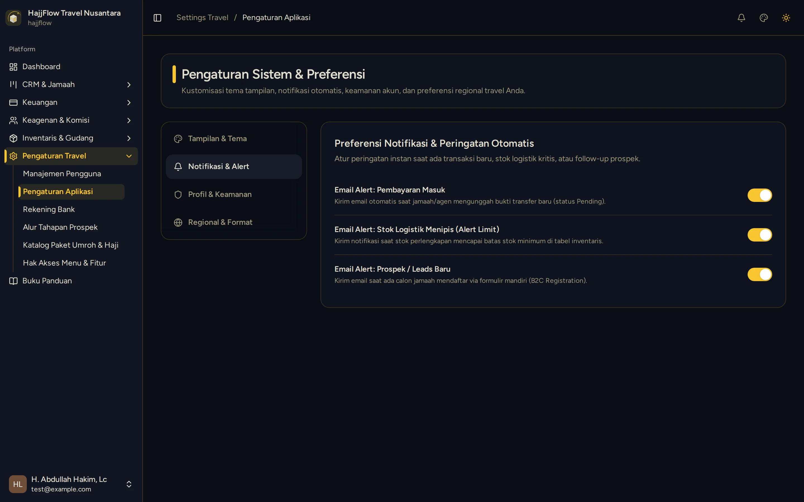

# Pengaturan Sistem, Notifikasi & Kustomisasi Tema

> **Target Peran**: `Owner (Level 1)` | **Login Akun**: `test@example.com`
> **Tahapan Alur**: `1. Setup & Konfigurasi Awal` | **Kategori**: `Pengaturan Sistem` | **Rute / URL**: `/settings/app`

## 📋 Deskripsi Fitur
Pusat preferensi sistem travel: pemilihan palet tema warna (Luxury, Emerald, Royal, Obsidian), konfigurasi notifikasi alert email/suara, dan format regional mata uang.

## 🖼️ Tampilan Antarmuka Utama

## 🗂️ Tampilan Drawer, Modal & Aksi Detail

### 📸 Tampilan Tab Notifikasi

## ⚡ Aksi & Fitur Lengkap (CRUD Matrix)

### 🔍 Read (Lihat / Pencarian / Filter Data)
- Melihat preview palet tema warna antarmuka travel.
- Melihat status preferensi alert pendaftaran jamaah, pembayaran, dan stok menipis.

### ✏️ Update (Edit / Pembaruan Status)
- Pilih tema visual yang diinginkan dengan sekali klik.
- Aktifkan atau matikan toggle notifikasi email dan audio alert.

## 🛠️ Langkah-Langkah Penggunaan

1. Buka menu Pengaturan Travel > Pengaturan Aplikasi.
2. Tab "Tampilan & Tema": Pilih palet tema yang sesuai dengan branding travel Anda.
3. Tab "Notifikasi & Alert": Atur pemberitahuan instan saat ada pembayaran baru atau stok kritis.

---
*Buku Panduan Resmi Sistem Travel Umroh Multi-Tenant.*
